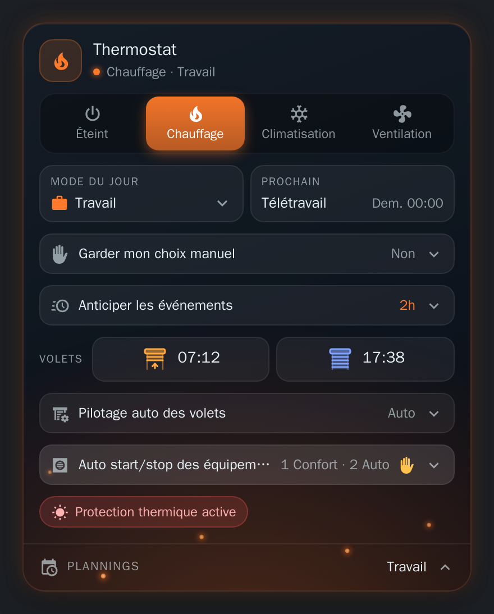

# HomeShift

[English](README.md) · **Français**

Une intégration Home Assistant qui pilote la maison depuis votre agenda : elle choisit le **mode du jour** (Maison, Travail, Télétravail, Absence) à partir de vos calendriers de travail et de jours fériés, active les **plannings** de ce mode, pilote les **volets** et l'**auto start/stop des équipements**, et fournit une **carte de tableau de bord** pour tout voir et tout commander.

  

## Fonctionnalités

| | |
| --- | --- |
| 📅 **Mode du jour selon l'agenda** | Jours ouvrés, week-ends, jours fériés et événements du calendrier (« Télétravail », « Vacances ») donnent chacun un mode. Événements d'une demi-journée, bascule anticipée avant un événement, choix manuel conservé un temps, mode Absence qui fige tout. → [Modes du jour](docs/fr/day-modes.md) |
| 🗓️ **Plannings par mode** | Les interrupteurs [Scheduler](https://github.com/nielsfaber/scheduler-component) du mode du jour tournent, les autres s'arrêtent. Un mode thermostat (Éteint, Chauffage, Climatisation, Ventilation) choisit les plannings de chauffage ou de climatisation et pilote les climatiseurs. → [Plannings](docs/fr/schedulers.md) |
| 🪟 **Volets** | Ouverture quotidienne (par mode du jour, heure fixe ou lever du soleil) et fermeture (à une élévation du soleil), capteurs de fenêtre qui laissent un volet ouvert, positions My, ouverture et fermeture à la demande, mise en pause de volets choisis, fermeture contre la chaleur (température ou prévisions). → [Volets](docs/fr/covers.md) |
| ♨️ **Auto start/stop des équipements** | Coupe l'auto start/stop de Versatile Thermostat tant que la consigne d'un équipement est du côté confort d'un seuil réglé pour chaque mode thermostat (pompe à chaleur, climatiseur...), pour qu'il tourne quand vous en avez besoin. → [Auto start/stop](docs/fr/climates.md) |
| 🖥️ **Carte de tableau de bord** | Livrée avec l'intégration, rien à installer : modes, volets, équipements et vue sur 24 h des plannings. → [La carte](docs/fr/card.md) |

## Prérequis

- **Home Assistant 2026.9** ou plus récent
- Un **calendrier** avec vos événements de travail ou d'agenda, et un **calendrier** des jours fériés
- En option : l'[intégration Scheduler](https://github.com/nielsfaber/scheduler-component) pour les plannings, [Versatile Thermostat](https://github.com/jmcollin78/versatile_thermostat) pour l'auto start/stop des équipements

## Installation

Ou à la main :

1. Ouvrez **HACS** dans Home Assistant, puis le menu ⋮ → **Dépôts personnalisés**
2. Ajoutez `https://github.com/Gamso/homeshift` avec la catégorie **Intégration**
3. Cherchez **HomeShift**, installez-la, puis redémarrez Home Assistant

La carte de tableau de bord est fournie avec : aucune ressource Lovelace à ajouter.

## Premiers pas

Une fois installée et Home Assistant redémarré :

Ou à la main :

1. **Paramètres → Appareils et services → Ajouter une intégration → HomeShift**
2. Deux étapes : choisissez vos calendriers de travail et des jours fériés, puis vérifiez le mode donné à chaque type de jour, et **Terminer**
3. Ajoutez la carte **HomeShift** à un tableau de bord (ou `type: custom:homeshift-card`)

HomeShift démarre aussitôt : il lit le calendrier toutes les 5 minutes (et à l'heure pile pour les changements qu'il peut prévoir) et règle `select.homeshift_day_mode`. Tout le reste (plannings, volets, équipements, noms affichés) se règle ensuite depuis **Configurer**, voir [Configuration](docs/fr/configuration.md).

## Documentation

| Page | Contenu |
| --- | --- |
| [Configuration](docs/fr/configuration.md) | La fenêtre d'options et chaque paramètre |
| [Modes du jour](docs/fr/day-modes.md) | Le choix du mode, les pannes de calendrier, les demi-journées, la bascule anticipée, le choix manuel |
| [Plannings](docs/fr/schedulers.md) | Interrupteurs Scheduler par mode du jour, étiquettes thermostat, climatiseurs |
| [Volets](docs/fr/covers.md) | Ouverture et fermeture quotidiennes, capteurs de fenêtre, positions My, pause, protection contre la chaleur |
| [Auto start/stop des équipements](docs/fr/climates.md) | Auto start/stop des équipements Versatile Thermostat selon un seuil de consigne |
| [La carte](docs/fr/card.md) | Ce que montre la carte, et ses options |
| [Entités et services](docs/fr/reference.md) | Chaque entité, attribut et service, les diagnostics |
| [Développement](docs/fr/development.md) | Organisation du dépôt, tests, construction de la carte, devcontainer |

## Licence

MIT
