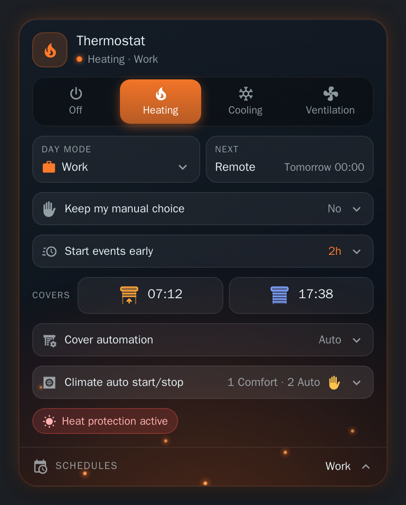

# HomeShift

**English** · [Français](README.fr.md)

A Home Assistant integration that runs your home from your calendar: it picks the **day mode** (Home, Work, Remote, Away) from your work and holiday calendars, switches the **schedules** of that mode on, drives the **covers** and the **climates' auto start/stop**, and ships a **dashboard card** to see and control it all.

  

## Features

| | |
| --- | --- |
| 📅 **Day mode from the calendar** | Work days, weekends, public holidays and calendar events ("Remote", "Vacation") each give a mode. Half-day events, early switch before an event, manual override with a timeout, an Away mode that freezes everything. → [Day modes](docs/en/day-modes.md) |
| 🗓️ **Schedules per mode** | The [Scheduler](https://github.com/nielsfaber/scheduler-component) switches of the current day mode run, the others stop. A thermostat mode (Off, Heating, Cooling, Ventilation) picks the heating or cooling schedules and drives the climates. → [Schedules](docs/en/schedulers.md) |
| 🪟 **Covers** | Daily open (per day mode, fixed time or sunrise) and close (at a sun elevation), window sensors that keep a cover up, My positions, open/close on demand, pause chosen covers, close against the heat (temperature or forecast). → [Covers](docs/en/covers.md) |
| ♨️ **Climate auto start/stop** | Turns Versatile Thermostat's auto start/stop off while a climate's setpoint is on the comfort side of a threshold you set for each thermostat mode (heat pump, air conditioner...), so it keeps running when you need it. → [Climate auto start/stop](docs/en/climates.md) |
| 🖥️ **Dashboard card** | Bundled with the integration, nothing to install: modes, covers, climates and a 24 h view of the schedules. → [The card](docs/en/card.md) |

## Requirements

- **Home Assistant 2026.9** or newer
- A **calendar** with your work or schedule events, and a **calendar** of public holidays
- Optional: the [Scheduler integration](https://github.com/nielsfaber/scheduler-component) for the schedules, [Versatile Thermostat](https://github.com/jmcollin78/versatile_thermostat) for the climate auto start/stop

## Installation

Or by hand:

1. Open **HACS** in Home Assistant, then the three-dot menu → **Custom repositories**
2. Add `https://github.com/Gamso/homeshift` with the category **Integration**
3. Search for **HomeShift**, install it, and restart Home Assistant

The dashboard card comes with it: no Lovelace resource to add.

## Getting started

Once installed and Home Assistant restarted:

Or by hand:

1. **Settings → Devices & Services → Add Integration → HomeShift**
2. Pick your work calendar and your holiday calendar, then **Save configuration**
3. Add the **HomeShift** card to a dashboard (or `type: custom:homeshift-card`)

HomeShift starts at once: it reads the calendar every 5 minutes (and on time for the changes it can predict) and sets `select.homeshift_day_mode`. Everything else (mode names, schedules, covers, climates) is set later from **Configure**, see [Configuration](docs/en/configuration.md).

## Documentation

| Page | What it covers |
| --- | --- |
| [Configuration](docs/en/configuration.md) | The options dialog and every parameter |
| [Day modes](docs/en/day-modes.md) | How the mode is chosen, calendar outages, half-day events, early switch, manual override |
| [Schedules](docs/en/schedulers.md) | Scheduler switches per day mode, thermostat tags, climates |
| [Covers](docs/en/covers.md) | Daily open and close, window sensors, My positions, pause, heat protection |
| [Climate auto start/stop](docs/en/climates.md) | Auto start/stop of Versatile Thermostat climates by setpoint threshold |
| [The card](docs/en/card.md) | What the card shows, and its options |
| [Entities and services](docs/en/reference.md) | Every entity, attribute and service, diagnostics |
| [Development](docs/en/development.md) | Repository layout, tests, building the card, devcontainer |

## License

MIT
