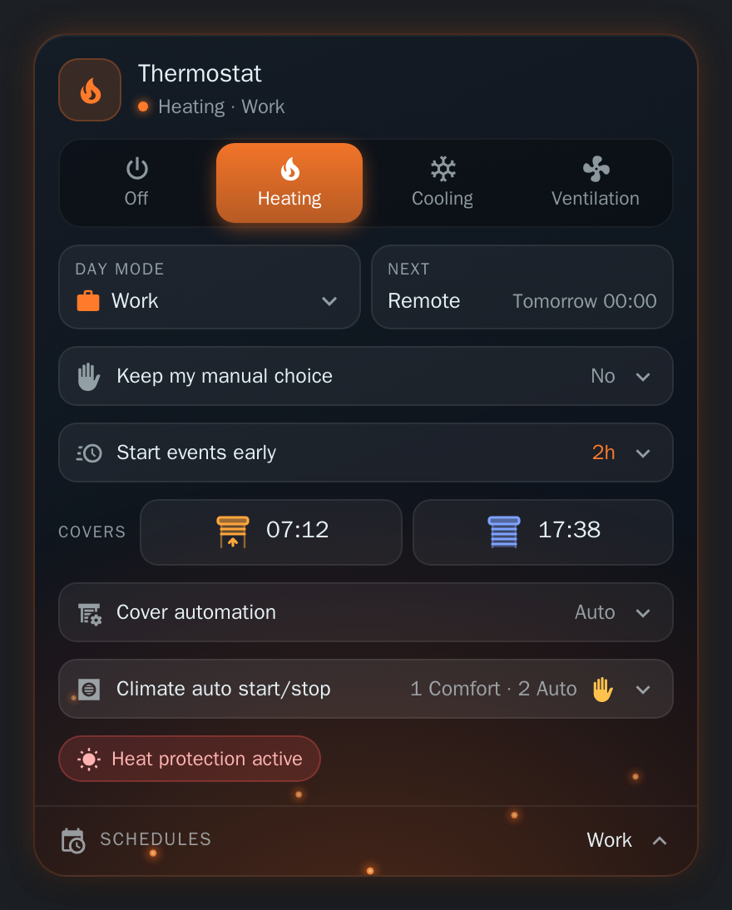
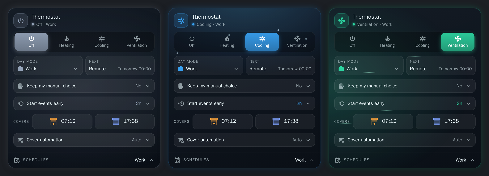
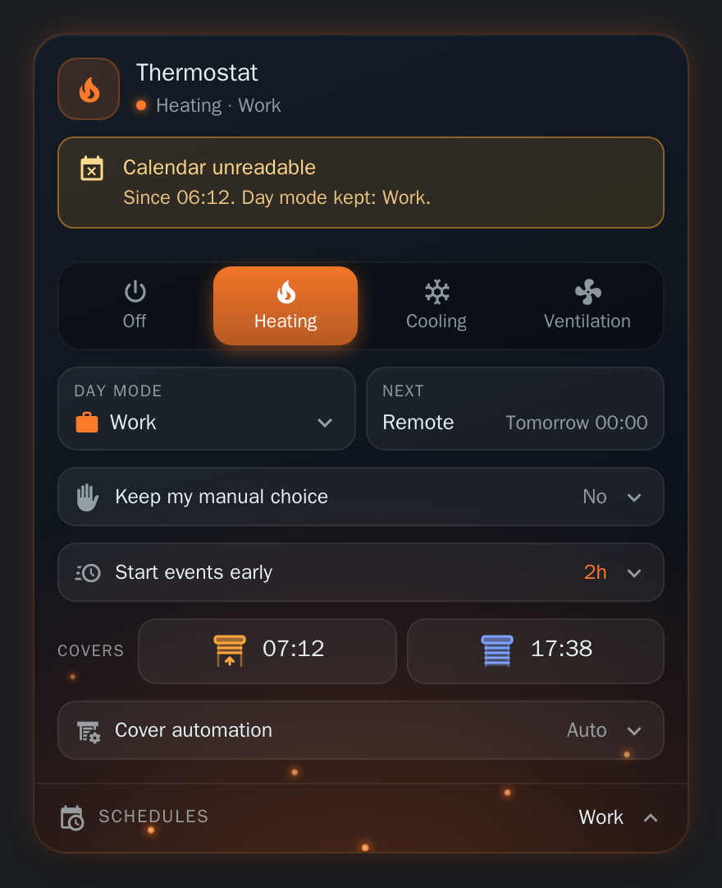
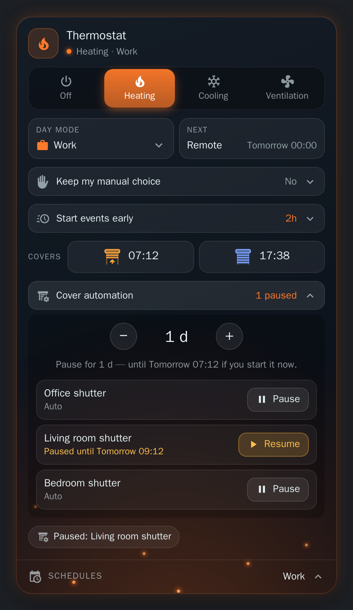
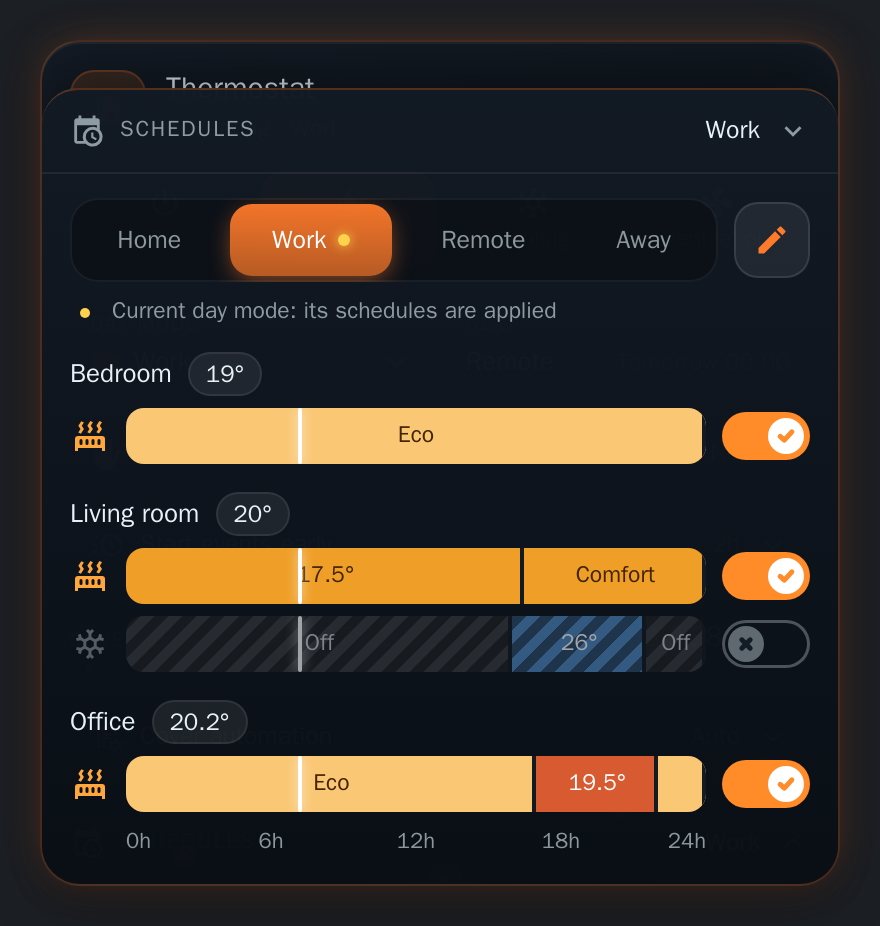

# The card

[← Documentation](../../README.md#documentation) · [Français](../fr/card.md)

A dashboard card to see and control HomeShift, in a dark glass style that takes the colour of the thermostat mode. It ships with the integration and loads by itself: no Lovelace resource to add.

<p align="center">
  
</p>

## Adding the card

**Edit dashboard → Add card → HomeShift**, or in YAML:

```yaml
type: custom:homeshift-card
```

Every entity option defaults to the entity HomeShift creates, so that line is enough. See [Options](#options) to change them. Reload the browser page after installing or updating the integration.

## What it shows

### Thermostat mode



The header shows the card's name, the thermostat mode in force and the day mode. Below it, one button per thermostat mode; the active one is filled with its colour. Tap a mode to switch to it (or Tab, then Enter or Space). The buttons are disabled while the thermostat mode entity is unavailable.

The whole card takes the colour of the active mode: border, header icon, a soft glow and a few particles:

| Mode | Colour | Ambience |
| --- | --- | --- |
| Off | Gray | Slow breathing glow |
| Heating | Orange | Embers rising |
| Cooling | Blue | Snowflakes falling |
| Ventilation | Green | Air streaks blowing across |

The animations stop when the system asks for reduced motion. Mode names are translated by the card (English, French); a mode of your own keeps the name given in the integration.

### Day mode and next mode

The **Day mode** tile is a dropdown to switch the [day mode](day-modes.md): each mode has its icon, the current one is ticked. From the keyboard, the arrows move through the modes, Enter or Space picks one, Escape closes the list.

The **Next** tile shows the next mode and when it starts (Today / Tomorrow + time, or the date when further away), in the 12 h / 24 h format of your profile. It is hidden while no change is scheduled.

### Calendar unreadable

When a work or holiday calendar is missing, `unavailable` or `unknown`, an amber banner under the title says since when and which day mode is kept (see [when a calendar is unreadable](day-modes.md#when-a-calendar-cannot-be-read)). It disappears as soon as the calendars answer.

<p align="center">
  
</p>

### Keep my manual choice / Start events early

Two rows show the [override duration and the early switch](day-modes.md#changing-the-mode-by-hand) ("No" when off). Tap one to open a stepper and a sentence explaining the effect: until when a manual change is kept, or when the next event really starts. The row folds back after a few seconds.

- **Keep my manual choice**: 15 min to 12 h.
- **Start events early**: 15 min to 4 h.

A value set elsewhere between two steps (25 min) is shown as is; the stepper moves to the next step in the direction asked for.

### Covers

The **Covers** row shows today's [opening and closing times](covers.md#daily-schedule), with a roller shutter icon: raised with an arrow (amber) for the opening, lowered (blue) for the closing. Each time is a button that [opens or closes the covers now](covers.md#opening-and-closing-on-demand); it shows "Sending…" meanwhile, and a failure appears in Home Assistant's notification toast. No confirmation is asked: the other button undoes it.

With the `cover_entity` option set, the times act on that cover (`open_cover` / `close_cover`) instead of pressing the buttons.

### Cover automation pause



Open the **Cover automation** row, pick a duration (4 h to 7 days, or until resumed), then press **Pause** next to each cover to [hold](covers.md#pausing-covers). A paused cover shows when it comes back; **Resume** (or **Resume all**) hands it back.

### Climate auto start/stop

When HomeShift drives the [auto start/stop of climates](climates.md), a foldable section lists them. Folded, its header sums up their states ("1 Comfort · 2 Auto", or just "Auto" for one climate), with an amber hand when one was flipped by hand. Unfolded, one row per climate:

| State | Shown as | Meaning |
| --- | --- | --- |
| **Auto** | green, leaf | Its setpoint is on the other side of the threshold: Versatile Thermostat may stop it. |
| **Comfort** | the mode's colour | Its setpoint is on the comfort side of the threshold: the climate keeps running. |
| Not driven | grey | The thermostat mode has no threshold for it, or the thermostat is off. |

Each row tells the climate's target temperature against the [threshold](climates.md#adding-a-climate) of the thermostat mode ("Setpoint 17.5° · may stop below 19°", or "runs up to 24°" in cooling).

Tap a climate to flip its auto start/stop by hand: the row says "Set by hand", and HomeShift takes over again at the next transition. A climate not driven, or whose switch is unavailable, cannot be tapped.

### Alerts

Chips appear at the bottom while something needs attention: heat protection keeping the covers down, the covers tonight's close had to leave open (blinking; past three, a count you can tap to read the names), and the paused covers (tap to open the pause row).

### Schedules



With the [Scheduler integration](schedulers.md), a **Schedules** bar at the foot of the card names the current day mode. Tap it to slide a panel up over the card:

- one tab per day mode, a dot marking the current one, and a line telling whether the shown mode's schedules are applied or off;
- the 24 h timelines of the schedules tagged with that mode, by room with the temperature measured there, heating first, then cooling;
- a line marking the current time; a disabled schedule stays readable, hatched and dimmed;
- a switch per row, ticked when the schedule runs (orange for heating, blue for cooling) and crossed when it is off. Turning a room's cooling on turns its heating off, and the other way round;
- a pencil that swaps the timelines for the [scheduler-card](https://github.com/nielsfaber/scheduler-card) list of the tab, to add and edit schedules.

Tap the bar again, or press Escape, to fold the panel. Tag each schedule with the **name of its day mode** (scheduler-card editor, **Options → Tags**): the bar only appears once a schedule carries such a tag.

## Options

A new card needs no setup: it finds the HomeShift entities by itself, even if you renamed them. All options can also be set from the card's visual editor, where the entities are in a folded "Entities (advanced)" section.

```yaml
type: custom:homeshift-card
name: Thermostat
show_schedules: true
schedule_entities:
  - climate.living_room
  - climate.bedroom
```

| Option | Default | What it does |
| --- | --- | --- |
| `name` | `Thermostat` | Title of the header |
| `show_schedules` | `true` | `false` hides the schedules panel |
| `schedule_entities` | *(all)* | Only the schedules acting on these entities, in the panel |
| `day_mode_entity` | `select.homeshift_day_mode` | Day mode |
| `thermostat_mode_entity` | `select.homeshift_thermostat_mode` | Thermostat mode |
| `override_duration_entity` | `number.homeshift_override_duration` | Keep my manual choice |
| `early_switch_entity` | `number.homeshift_early_switch` | Start events early |
| `next_mode_entity` | `sensor.homeshift_next_mode` | Next mode |
| `next_mode_at_entity` | `sensor.homeshift_next_mode_at` | Time of the next mode |
| `cover_open_time_entity` | `sensor.homeshift_cover_open_time` | Opening time |
| `cover_close_time_entity` | `sensor.homeshift_cover_close_time` | Closing time |
| `open_covers_entity` | `button.homeshift_open_covers` | Pressed by the opening time |
| `close_covers_entity` | `button.homeshift_close_covers` | Pressed by the closing time |
| `cover_entity` | *(none)* | A cover the times act on directly, instead of the buttons |
| `heat_protection_entity` | `binary_sensor.homeshift_cover_heat_active` | Heat protection chip |
| `covers_left_open_entity` | `binary_sensor.homeshift_covers_left_open` | "Not closed" chip |
| `covers_inhibited_entity` | `sensor.homeshift_covers_inhibited` | Pause row and "Paused" chip |
| `auto_start_stop_entity` | `sensor.homeshift_auto_start_stop` | Climate auto start/stop section |

The *Default* of an entity option is what the card uses when HomeShift's own entity is not found in the entity registry. Setting an option replaces the detected entity. Set an entity option to an empty string to hide what it drives. If the day mode or thermostat mode entity does not exist, the card says so instead of showing the controls.
