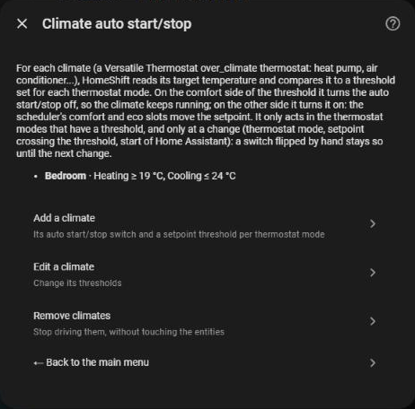
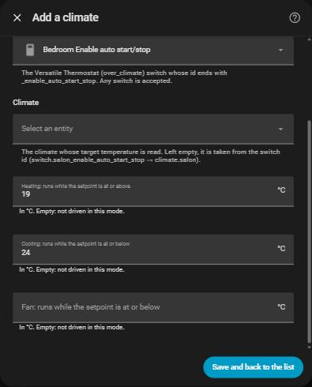
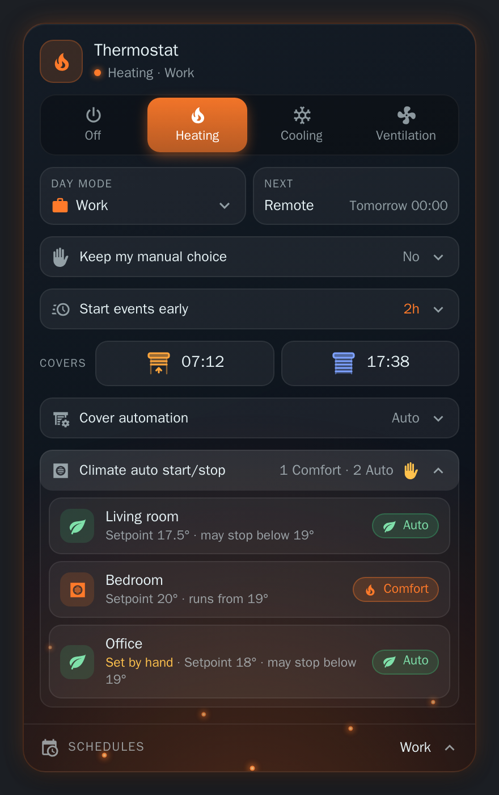

# Climate auto start/stop

[← Documentation](../../README.md#documentation) · [Français](../fr/climates.md)

[Versatile Thermostat](https://github.com/jmcollin78/versatile_thermostat/blob/main/documentation/en/feature-auto-start-stop.md) can stop a climate that has nothing to do, and restart it when needed. This works for its `over_climate` thermostats, whatever the equipment behind them (heat pump, air conditioner, reversible unit...). Each such thermostat has a `switch.<thermostat>_enable_auto_start_stop` that turns the feature on or off.

HomeShift drives that switch from the climate's **target temperature**. For each thermostat mode you set a **setpoint threshold**: your scheduler's comfort slots (a high temperature in heating, a low one in cooling) keep the climate running, and its eco slots let Versatile Thermostat stop it.

| Thermostat mode | Setpoint on the comfort side | Auto start/stop | The climate |
| --- | --- | --- | --- |
| **Heating** | at or above the threshold | turned **off** | keeps running |
| **Cooling**, **Ventilation** | at or below the threshold | turned **off** | keeps running |
| Any of them | on the other side | turned **on** | may be stopped by Versatile Thermostat |

## Adding a climate

**Configure → Climate auto start/stop → Add a climate**:

| Field | What to set |
| --- | --- |
| **Auto start/stop switch** | The thermostat's switch, whose id ends with `_enable_auto_start_stop`. Any switch is accepted. |
| **Climate** | The climate whose target temperature is read. Left empty, it is deduced from the switch (`switch.salon_enable_auto_start_stop` is `climate.salon`). |
| One threshold per thermostat mode | In °C, labelled with its rule: *Heating: runs while the setpoint is at or above*, *Cooling* and *Ventilation: runs while the setpoint is at or below*. Leave a mode empty and HomeShift does not drive the switch in it. At least one is needed. |

Each climate has its own thresholds. **Edit a climate** changes them and shows the climate's current setpoint, **Remove climates** stops driving the switches (they keep their state).

### Example

A living room unit that must keep running while the scheduler asks for at least 19° when heating, and for at most 24° when cooling:

| Thermostat mode | Threshold | Eco slot (setpoint 17.5°) | Comfort slot (setpoint 20°) |
| --- | --- | --- | --- |
| Heating | `19` | auto start/stop **on**, may stop | auto start/stop **off**, runs |
| Cooling | `24` | setpoint 28°: **on**, may stop | setpoint 23°: **off**, runs |
| Ventilation | *(empty)* | not driven | not driven |

The setpoint is read on the climate, so it works whether your scheduler sets a temperature (`climate.set_temperature`) or a preset (`eco`, `comfort`): Versatile Thermostat turns the preset into the setpoint the climate reports.

## When HomeShift acts

At each transition only:

- a thermostat mode change,
- a setpoint that crosses its threshold, as soon as the climate reports it,
- the start of Home Assistant.

It never fights you in between: a switch flipped by hand, from its entity or from the card, stays as it is until the next transition. An unavailable switch is skipped, and so is a climate with no target temperature at the moment (off, unavailable): its switch is left as it is. The day mode does not matter.

## Seeing it

`sensor.homeshift_auto_start_stop` counts the climates kept running and describes each one in its `climates` attribute (see the [reference](reference.md#sensorhomeshift_auto_start_stop)).

The [card](card.md#climate-auto-startstop) shows them in a foldable section: **Auto** (Versatile Thermostat may stop it), **Comfort** (it runs), or not driven, with the setpoint against the threshold and a tap to flip one by hand.

  

