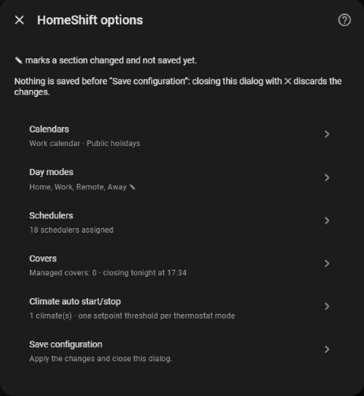

# Configuration

[← Documentation](../../README.md#documentation) · [Français](../fr/configuration.md)

Everything is set from **Settings → Devices & Services → HomeShift → Configure**, and can be changed at any time.

Each entry of the menu shows a summary of its settings. Saving a page brings you back to the menu, and **✎** marks the entries changed and not saved yet. **Nothing is stored until Save configuration**: closing the dialog with ✕ drops the changes.

Each page of the dialog is described, with its screenshot, on the page of the feature it configures:

| Menu entry | What it sets | Documented in |
| --- | --- | --- |
| **Calendars** | The work and holiday calendars | [Day modes → Calendars](day-modes.md#calendars) |
| **Day modes** | How the mode is chosen, and the names of the modes | [Day modes → Mode rules](day-modes.md#mode-rules) and [Mode names](day-modes.md#mode-names) |
| **Schedulers** | The scheduler switches of each day mode | [Schedules](schedulers.md#schedules-per-day-mode) |
| **Covers → Managed covers** | The covers opened and closed every day | [Covers → The covers](covers.md#the-covers) |
| **Covers → Opening and closing times** | When the covers open and close | [Covers → Daily schedule](covers.md#daily-schedule) |
| **Covers → Heat protection** | The covers closed against the heat | [Covers → Heat protection](covers.md#heat-protection) |
| **Climate auto start/stop** | The auto start/stop switches and a setpoint threshold per thermostat mode | [Climate auto start/stop](climates.md#adding-a-climate) |

The override duration and the early switch are not in this dialog: see [Day modes](day-modes.md#settings).
