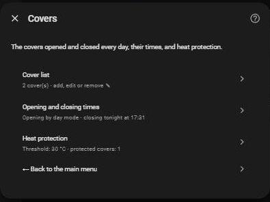
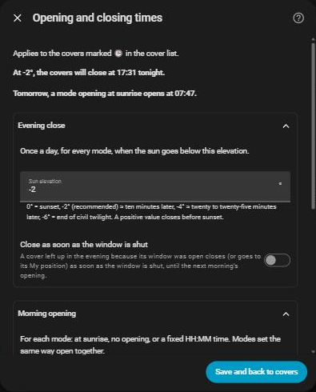
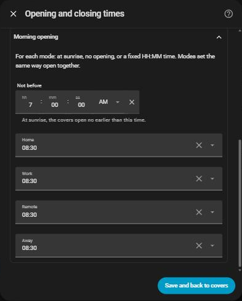
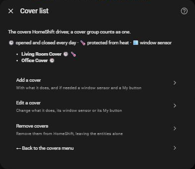
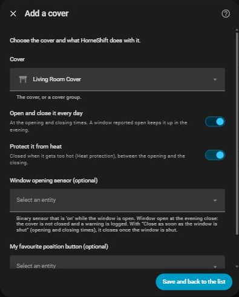
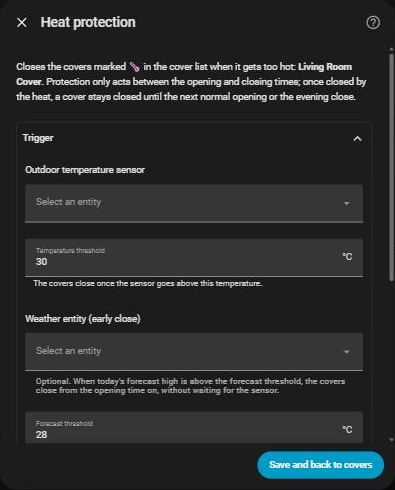
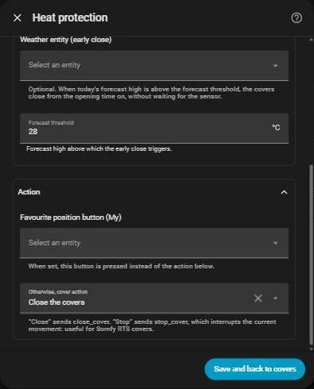

# Covers

[← Documentation](../../README.md#documentation) · [Français](../fr/covers.md)

HomeShift opens and closes covers every day without any Scheduler entity, keeps a cover up when its window is open, lets you pause chosen covers, and closes some of them against the heat. Everything is set under **Configure → Covers**:

| Menu | What it sets |
| --- | --- |
| **Cover list** | The covers, one at a time: opened and closed every day, protected from heat, or both, each with an optional window sensor and My button. See [The covers](#the-covers) |
| **Opening and closing times** | When they open (per day mode) and close (sun elevation). See [Daily schedule](#daily-schedule) |
| **Heat protection** | When the covers protected from heat close. See [Heat protection](#heat-protection) |

## Daily schedule

Once a day, shortly after midnight, HomeShift computes today's times:

- **Opening**, per [day mode](day-modes.md), one field per mode under **Morning opening**:
  - `sunrise`: at sunrise, but never before **Not before** (`07:00` by default),
  - `skip`: no opening that day (the covers stay as they are; heat protection still runs),
  - a fixed time, `HH:MM` (`08:30` by default).
- **Closing**, the same for every mode: when the setting sun reaches the **Sun elevation** of the evening close, see [When the covers close](#when-the-covers-close).

If the day mode changes before the covers opened (an all-day event the calendar shows a few minutes after midnight, a mode picked by hand in the morning), the opening time is computed again for the new mode. Once the covers opened, a later change leaves the day's times as they are.

A timer fires each action at its minute, and the 5-minute poll catches up if the timer was missed (a restart). Each action runs at most once a day. A command that fails (a cover integration timing out, an entity removed) is logged and sent again at the next poll; it never makes the HomeShift entities unavailable.

`sensor.homeshift_cover_open_time` and `sensor.homeshift_cover_close_time` show today's times.

### Settings

Under **Covers → Opening and closing times**. The page tells tonight's closing time and tomorrow's opening of a mode set to `sunrise`, so you see what an elevation or a "not before" time gives:

| Field | Default | What it does |
| --- | --- | --- |
| **Morning opening**, one field per day mode | `08:30` | `sunrise`, `skip` (no opening) or a time `HH:MM` |
| **Not before** | `07:00` | The earliest a `sunrise` opening can be, and the start of heat protection on a `skip` day |
| **Sun elevation** (evening close) | `-2°` | The covers close when the setting sun reaches it, see below |
| **Close as soon as the window is shut** | off | See [Closing once the window is shut](#closing-once-the-window-is-shut) |

### When the covers close

The covers close when the setting sun reaches the **Sun elevation** (evening close) set, in degrees above the horizon, on the scale of `{{ state_attr('sun.sun', 'elevation') }}`. You set a **light level**, not a delay:

| Elevation | Roughly | Light |
| --- | --- | --- |
| `+2°` | Sunset − ~15 min | The sun is still up |
| `0°` | Sunset | The sun touches the horizon |
| `-2°` *(default)* | Sunset + ~10 min | Dusk, still easy to see outside |
| `-4°` | Sunset + ~20-25 min | The room is dark |
| `-6°` | Sunset + ~35-40 min | End of civil twilight, lights needed |

The "roughly" column is a mid-latitude approximation: the delay shifts a little with latitude and season, the light level does not. The form turns the value into tonight's time at your location (**At -2°, the covers will close at 21:41 tonight.**).

The form refuses an elevation the sun never reaches at your location (a positive value the midwinter sun stays below, anything above the polar circle in June). Should it become unreachable anyway (a home that moved, an entry restored elsewhere), the covers close at plain sunset and a warning is logged.

## The covers

Add the covers one at a time under **Covers → Cover list**. A cover group is a cover like any other, so a whole house can be a single entry. Each cover says what HomeShift does with it, and the list shows it with a symbol:

- 🕒 **Open and close it every day**, at the [daily times](#daily-schedule) (on by default),
- 🌡️ **Protect it from heat**, see [Heat protection](#heat-protection),

at least one of the two, and can have:

- a **Window opening sensor** (a `binary_sensor` that is `on` while the window is open),
- a **My favourite position button**, for a cover that should not close fully.

**Edit a cover** changes what it does, its sensor or its button (clear a field to remove it).

### Window sensors

**The evening close skips a cover whose window is open.** HomeShift leaves it up and logs a warning, and `binary_sensor.homeshift_covers_left_open` names it until the next day.

- The morning open is never skipped: an open window is only a reason not to close.
- A sensor that is missing or `unavailable` cannot tell the window is open: the cover closes as usual, with a warning.
- A cover reached through a group is not protected: HomeShift sends the close to the entities you listed and does not look inside a group. List such a cover on its own (and drop it from the group).

#### Closing once the window is shut

With **Close as soon as the window is shut** on (*Opening and closing times*, **Evening close**), a cover left up because of its window closes as soon as that window is shut:

- only at night, from the evening close to the next morning open (past midnight still counts),
- to its My position if it has one,
- not if it was already lowered by hand, nor while it is [paused](#pausing-covers) (it keeps waiting),
- not while the sensor is `unavailable` (it keeps waiting),
- even across a restart: a window shut while Home Assistant was down is caught up at the next poll.

Without that option, a skipped cover stays up for the night, and the warning is the signal to close it by hand.

### My position instead of a full close

Give a cover a **My favourite position button** (the button that sends a Somfy RTS or similar cover to its favourite position) and the evening close presses that button instead of sending `close_cover`. An open window still wins, and the morning open does not change. This is per cover, separate from heat protection's own My button.

## Opening and closing on demand

`button.homeshift_open_covers` and `button.homeshift_close_covers` (and the `homeshift.open_covers` / `homeshift.close_covers` actions, and the times on the [card](card.md#covers)) send the daily commands at any time:

- **Open** opens every cover of the list, even on a `skip` day.
- **Close** follows the evening rules: a cover with an open window stays up, a cover with a My button gets a press.
- The day's schedule does not change: the scheduled actions still run at their time.
- [Paused](#pausing-covers) covers are left alone.

## Pausing covers

Keep covers out of the automation for a while, e.g. a bedroom kept dark for a few days. A paused cover gets neither the daily open nor the close, heat protection leaves it alone, and the on-demand commands skip it. A pause lasts a duration, until a date, or until resumed, and survives a restart.

Pause and resume from the [card](card.md#cover-automation-pause), or with the [`homeshift.inhibit_covers` and `homeshift.resume_covers`](reference.md#homeshiftinhibit_covers) actions. `sensor.homeshift_covers_inhibited` lists the paused covers.

Pausing or resuming never moves a cover. When a pause ends, the cover takes part in the next scheduled action; a missed morning open is not replayed in the afternoon. Heat protection is the exception: it stays armed, so a cover released on a hot afternoon can still be closed by it. A heat protection My button moves all its covers at once, so it is not pressed while any of them is paused.

## Heat protection

HomeShift can close covers against the heat, without any automation and without a time window of its own. It acts on the covers marked 🌡️ **Protect it from heat** in the [cover list](#the-covers), daily or not, so a south-facing cover can stay under heat protection while the others only follow the daily schedule.

**It needs the daily schedule to be set up**: it runs from today's opening time to today's closing time. On a `skip` day (typically *Away*), it starts at the sunrise-based time instead: `skip` stops the opening, never the protection, since nobody is home to close the cover by hand. If it is already hot when the covers would open, the protected position applies at once instead of opening first.

Once closed by heat protection, a cover stays so for the rest of the day; it is moved again by the next day's opening or by the evening close. `binary_sensor.homeshift_cover_heat_active` is `on` while the conditions are met.

### Settings

Under **Covers → Heat protection**:

| Field | Default | What it does |
| --- | --- | --- |
| **Outdoor temperature sensor** | — | The temperature watched |
| **Temperature threshold** | `30 °C` | Above it, the covers close |
| **Weather entity (early close)** | — | Daily forecasts, for the proactive close (optional) |
| **Forecast threshold** | `28 °C` | Above this forecast high, the covers close in the morning |
| **Favourite position button (My)** | — | Pressed instead of the cover action |
| **Otherwise, cover action** | `close_cover` | `close_cover`, or `stop_cover` to stop the movement |

### Reactive close

Whenever the poll runs and whenever the temperature sensor changes, if today's window is open and the outdoor temperature is above the **Temperature threshold** (`30 °C` by default), HomeShift presses the **Favourite position button (My)** if one is set, or else applies the **Cover action**: `close_cover` (default) or `stop_cover` (stops the movement, useful for Somfy RTS covers).

It fires at most once a day. Nothing is sent when every protected cover already reads `closed`, and a command that fails is tried again at the next check.

### Proactive close (forecast)

With a **Weather entity (early close)** (daily forecasts), HomeShift also checks once a day, at the start of the window, whether today's forecast high is above the **Forecast threshold** (`28 °C` by default). If so, the covers close at once (or do not open at all), before the outdoor sensor crosses the threshold. The reactive close still runs for the rest of the day, in case the forecast was wrong. Leave the weather entity empty to keep the reactive close only.

## After a restart

What the covers already did today (opened, closed, closed against the heat, forecast checked), the covers left open, those waiting for their window and the pauses are saved, so a restart in the middle of the day loses nothing. This state is deleted with the integration.
