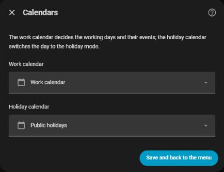
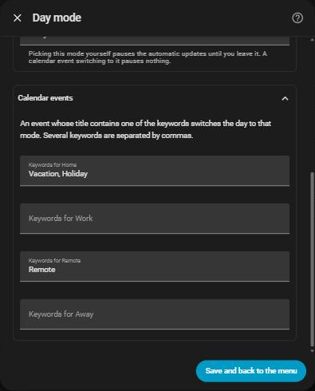
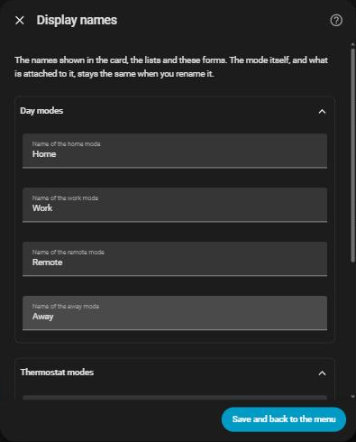

# Day modes

[← Documentation](../../README.md#documentation) · [Français](../fr/day-modes.md)

HomeShift keeps one **day mode** for the whole home, shown and set by `select.homeshift_day_mode`. There are four, with fixed keys and names you can change (see [Mode names](#mode-names)):

| Key | English | French |
| --- | --- | --- |
| `home` | Home | Maison |
| `work` | Work | Travail |
| `remote` | Remote | Télétravail |
| `away` | Away | Absence |

Every 5 minutes, and on time for the changes it can predict, HomeShift reads your calendars, picks the mode, and turns the [schedules](schedulers.md) of that mode on and the others off. The [covers](covers.md) and the [climates' auto start/stop](climates.md) follow the mode too.

## How the mode is chosen

HomeShift looks at the event active now in your work calendar, and at your holiday calendar, in this order:

| Priority | Condition | Mode |
| --- | --- | --- |
| 1 | The active calendar event contains a **Calendar events** keyword | The mapped mode (e.g. `Remote`) |
| 2 | A timed event that matches the map starts within the [early switch](#early-switch) | The mapped mode, ahead of time |
| 3 | Today is Saturday or Sunday | The **Weekend** mode |
| 4 | Today is a public holiday | The **Public holiday** mode |
| 5 | Nothing of the above | The **Working day** mode (e.g. `Work`) |

The **Calendar events** keywords link words of event titles to modes: `Vacation` gives *Home* and `Remote` gives *Remote* by default (`Vacances` and `Télétravail` on a French instance). A keyword matches anywhere in the title, whatever the case.

`sensor.homeshift_next_mode` and `sensor.homeshift_next_mode_at` tell the next mode and when it starts, and a timer switches the mode at that minute rather than at the next poll.

## Settings

Set when adding HomeShift, then under **Configure → Calendars**, **Configure → Day mode** and **Configure → Display names**, see [Configuration](configuration.md) for how the dialog works.

### Calendars



| Field | What it does |
| --- | --- |
| **Work calendar** | The calendar with your work or schedule events (required) |
| **Holiday calendar** | The calendar of public holidays (required) |

### Mode rules



| Field | Default | What it does |
| --- | --- | --- |
| **Working day** | `Work` | Mode of a regular weekday with no event |
| **Weekend** | `Home` | Mode of Saturdays and Sundays |
| **Public holiday** | `Home` | Mode of public holidays |
| **Away mode (pauses the automation)** | `Away` | When *you* pick this mode, the calendar stops changing it, see [The Away mode](#the-away-mode) |
| **Keywords for** each mode | `Vacation` for Home, `Remote` for Remote | Words of event titles that switch the day to that mode, separated by commas (`Vacances`, `Télétravail` on a French instance). A keyword given for two modes is refused. |

### Mode names



Under **Configure → Display names**: the name of each **day mode** and of each **thermostat mode**. The four day modes (keys `home`, `work`, `remote`, `away`) and the four thermostat modes (`off`, `heating`, `cooling`, `ventilation`) can be renamed, not added or removed. The thermostat mode names are also the [scheduler tags](schedulers.md#thermostat-tags).

The **override duration** and the **early switch** are not in this dialog: set them from their entities (`number.homeshift_override_duration`, `number.homeshift_early_switch`) or from the [card](card.md). See [Early switch](#early-switch) and [Changing the mode by hand](#changing-the-mode-by-hand).

## Half-day events

A calendar event covering only the morning or only the afternoon applies its mode during that time only: the mode goes back to the default for the rest of the day.

## Early switch

The **early switch** (`number.homeshift_early_switch`, 0 to 480 minutes, `0` by default) starts a timed event's mode ahead of the event, for instance to give the heating time to warm the house:

```
Calendar event:  Remote working  14:00 ──────────── 18:00
early_switch = 120 min
                             ↑
                          12:00  ← HomeShift switches to Remote here
```

- It only applies to **timed** events: all-day events (public holidays) are never started early.
- `sensor.homeshift_next_mode_at` shows the anticipated time, not the event start.
- `0` turns the early switch off.

## Changing the mode by hand

Pick a mode from the select (or the card) at any time. The **override duration** (`number.homeshift_override_duration`, 0 to 1440 minutes, `0` by default) then keeps your choice for that long before the calendar takes over again. `0` lets the next calendar pass replace it. A running override survives a restart.

### The Away mode

When **you** pick the **Mode that pauses the automation** (`Away` by default), HomeShift stops changing the mode until you pick another one: that is the point of the mode.

A calendar event mapped to the Away mode does **not** freeze anything: it sets the mode like any other event, and the mode moves on once the event ends. Otherwise a single event would freeze the integration for good.

## When a calendar cannot be read

A work or holiday calendar that is missing, `unavailable` or `unknown` (a CalDAV or Google outage, an integration still loading at startup) says nothing about today, so HomeShift does **not** read it as "no event". It keeps the current mode, logs one warning when the outage starts and one line when it ends, and goes back to normal as soon as the calendar answers. A remote-work day does not flip to *Work* and back, and an absence set by a calendar event is not cancelled.

The [card](card.md#calendar-unreadable) shows an amber banner for as long as the outage lasts, and the day mode select carries the start of the outage in its `calendar_error` attribute.

The covers do not wait for the calendar: their schedule keeps running, computed from the mode kept so far, and computed again once the calendar answers.

## After a restart

The day mode, the thermostat mode and a running manual override are saved and restored when Home Assistant starts.
