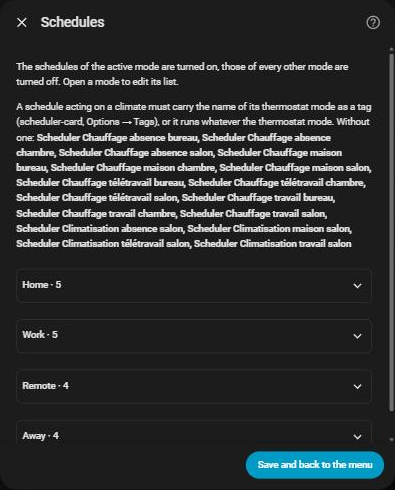

# Schedules

[← Documentation](../../README.md#documentation) · [Français](../fr/schedulers.md)

HomeShift drives the switches of the [Scheduler integration](https://github.com/nielsfaber/scheduler-component) from the [day mode](day-modes.md) and the thermostat mode, so the right heating, cooling or lighting schedules run without any automation to write.

## Schedules per day mode

Under **Configure → Schedules**, assign one or more scheduler switches to each day mode. When the day mode changes:

- the switches of the **current mode** are turned **on**,
- the switches of **every other mode** are turned **off**.

For instance, a heating schedule for remote-work days and another for office days, each running only on its own days.

The assignments are stored by mode **key** (`home`, `work`, ...), so renaming a mode or changing the language of Home Assistant keeps them. A switch that does not respond (deleted, Scheduler integration unloaded) is reported in the log and does not stop the others.

The page names the assigned schedules that act on a climate without any thermostat tag (see below): they run whatever the thermostat mode, Off included, which is almost always a forgotten tag.

`homeshift.refresh_schedulers` applies the switches again on demand.

## Thermostat mode

`select.homeshift_thermostat_mode` (`Off`, `Heating`, `Cooling`, `Ventilation` by default) picks which climate schedules may run. HomeShift recognises them by their **tags**.

### Thermostat tags

Give each scheduler that heats or cools the **name of its thermostat mode as a tag** (in the scheduler-card editor, **Options → Tags**), exactly as it is named in HomeShift:

| Scheduler switch | Tags | Purpose |
| --- | --- | --- |
| `switch.schedule_home_heating` | `Heating` | Heating when you are at home |
| `switch.schedule_work_heating` | `Heating` | Heating on office days |
| `switch.schedule_home_cooling` | `Cooling` | Cooling when you are at home |
| `switch.schedule_presence_light` | *(none)* | Lights, nothing to do with the thermostat |

A tagged scheduler only runs while the thermostat is in its mode (and its day mode is the current one). With the thermostat **Off**, every tagged scheduler is turned off, whatever the day mode. Schedulers without a thermostat tag only follow the day mode.

### Climates

Turning a scheduler off leaves its climate as it was: a heat pump cooling when **Off** is picked would keep cooling. So a change of thermostat mode (from the select or the card) also drives the `climate` entities the tagged schedulers act on:

- **Off**: every one of them is turned off (`hvac_mode: off`).
- **Heating / Cooling / Ventilation**: the climates of the schedulers tagged with that mode switch to `heat` / `cool` / `fan_only` (when they support it), and the enabled schedulers of that mode run their current slot (`scheduler.run_action`), so the setpoint applies right away. Climates only driven by schedulers of another mode are turned off.

A climate already in the right mode, unavailable, or without that HVAC mode is left alone. Climates no tagged scheduler acts on are never touched.

## On the card

With the Scheduler integration, the [card](card.md#schedules) shows the schedules of each day mode as 24 h timelines, and edits them. Tag each schedule with the **name of its day mode** too, for the card to find it.
