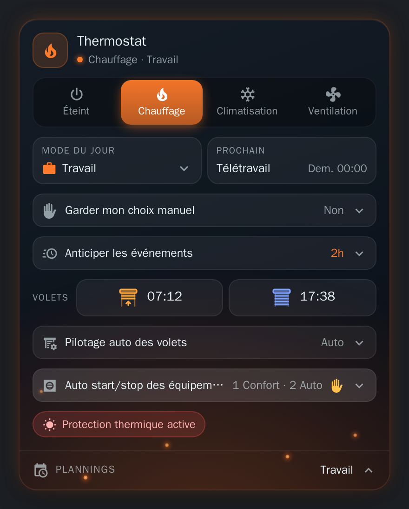
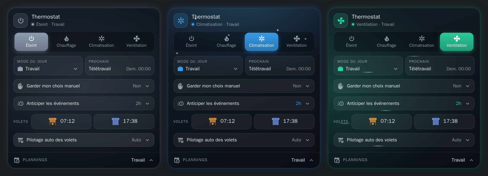
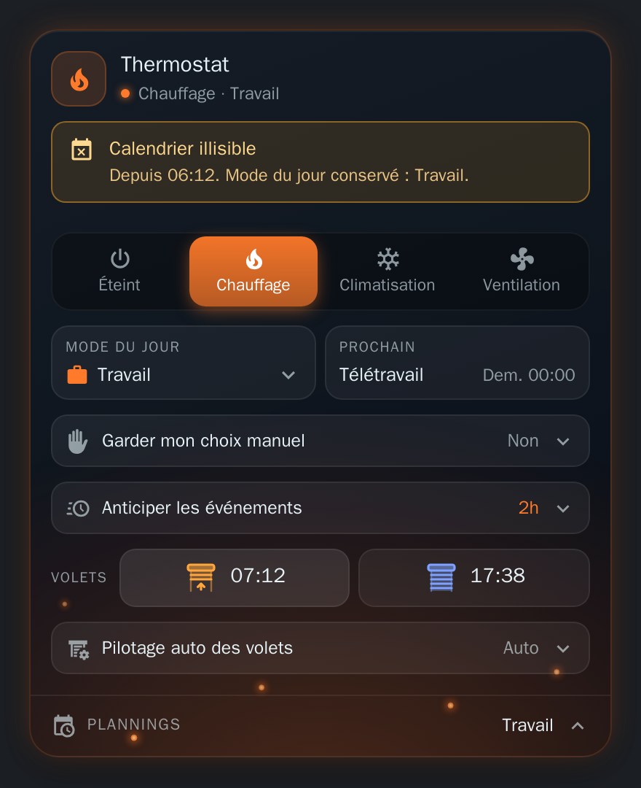
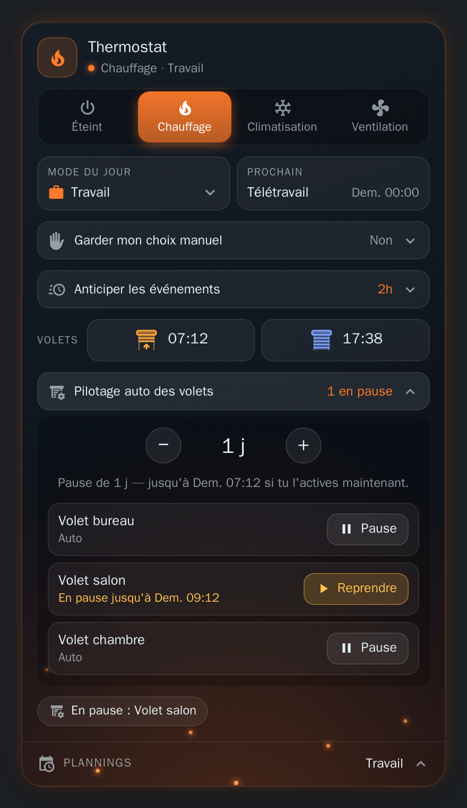
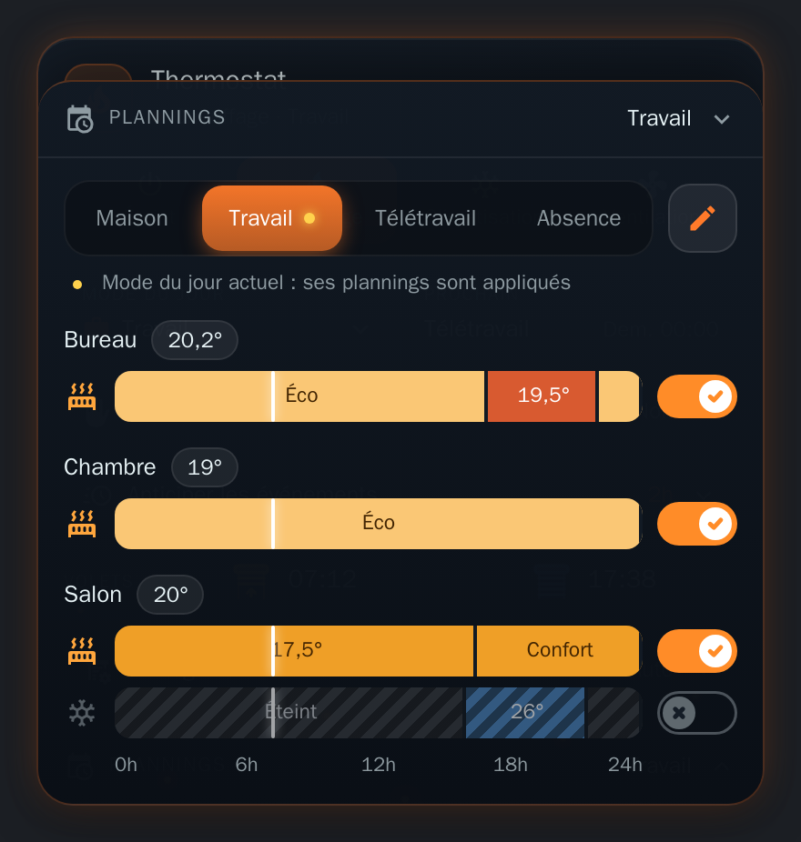

# La carte

[← Documentation](../../README.fr.md#documentation) · [English](../en/card.md)

Une carte de tableau de bord pour voir et piloter HomeShift, dans un style verre sombre qui prend la couleur du mode thermostat. Elle est fournie avec l'intégration et se charge toute seule : aucune ressource Lovelace à ajouter.

<p align="center">
  
</p>

## Ajouter la carte

**Modifier le tableau de bord → Ajouter une carte → HomeShift**, ou en YAML :

```yaml
type: custom:homeshift-card
```

Chaque option d'entité vaut par défaut l'entité créée par HomeShift : cette ligne suffit. Voir [Options](#options) pour les changer. Rechargez la page du navigateur après avoir installé ou mis à jour l'intégration.

## Ce qu'elle montre

### Mode thermostat



L'en-tête affiche le nom de la carte, le mode thermostat en cours et le mode du jour. En dessous, un bouton par mode thermostat ; le mode actif est rempli de sa couleur. Appuyez sur un mode pour y passer (ou Tab, puis Entrée ou Espace). Les boutons sont désactivés tant que l'entité du mode thermostat est indisponible.

Toute la carte prend la couleur du mode actif : bordure, icône de l'en-tête, halo et quelques particules :

| Mode | Couleur | Ambiance |
| --- | --- | --- |
| Éteint | Gris | Halo qui respire lentement |
| Chauffage | Orange | Braises qui montent |
| Climatisation | Bleu | Flocons qui tombent |
| Ventilation | Vert | Filets d'air qui traversent |

Les animations s'arrêtent quand le système demande moins d'animations. Les noms des modes sont traduits par la carte (anglais, français) ; un mode à vous garde le nom donné dans l'intégration.

### Mode du jour et prochain mode

La tuile **Mode du jour** est une liste déroulante pour changer de [mode du jour](day-modes.md) : chaque mode a son icône, le mode en cours est coché. Au clavier, les flèches parcourent les modes, Entrée ou Espace en choisit un, Échap ferme la liste.

La tuile **Prochain** affiche le prochain mode et son heure (Aujourd'hui / Demain + heure, ou la date s'il est plus loin), au format 12 h / 24 h de votre profil. Elle est masquée quand aucun changement n'est prévu.

### Calendrier illisible

Quand un calendrier de travail ou de jours fériés est absent, `unavailable` ou `unknown`, un bandeau ambre sous le titre indique depuis quand et quel mode du jour est conservé (voir [quand un calendrier est illisible](day-modes.md#quand-un-calendrier-est-illisible)). Il disparaît dès que les calendriers répondent.

<p align="center">
  
</p>

### Garder mon choix manuel / Anticiper les événements

Deux lignes montrent la [durée de surcharge et la bascule anticipée](day-modes.md#changer-le-mode-à-la-main) (« Non » quand elles sont désactivées). Appuyez sur l'une pour ouvrir un sélecteur et une phrase qui explique l'effet : jusqu'à quand un changement manuel est gardé, ou quand l'événement suivant commence vraiment. La ligne se replie après quelques secondes.

- **Garder mon choix manuel** : de 15 min à 12 h.
- **Anticiper les événements** : de 15 min à 4 h.

Une valeur réglée ailleurs entre deux crans (25 min) s'affiche telle quelle ; le sélecteur passe au cran suivant dans le sens demandé.

### Volets

La ligne **Volets** affiche les [horaires d'ouverture et de fermeture](covers.md#horaires-quotidiens) du jour, avec une icône de volet roulant : relevé avec une flèche (ambre) pour l'ouverture, baissé (bleu) pour la fermeture. Chaque horaire est un bouton qui [ouvre ou ferme les volets tout de suite](covers.md#ouvrir-et-fermer-à-la-demande) ; il affiche « Envoi… » pendant ce temps, et un échec apparaît dans la notification de Home Assistant. Aucune confirmation n'est demandée : l'autre bouton annule.

Avec l'option `cover_entity`, les horaires agissent directement sur ce volet (`open_cover` / `close_cover`) au lieu d'appuyer sur les boutons.

### Pilotage auto des volets



Ouvrez la ligne **Pilotage auto des volets**, choisissez une durée (de 4 h à 7 jours, ou jusqu'à reprise), puis appuyez sur **Pause** à côté de chaque volet à [garder](covers.md#mettre-des-volets-en-pause). Un volet en pause indique quand il revient ; **Reprendre** (ou **Tout reprendre**) le rend à l'automatisation.

### Auto start/stop des équipements

Quand HomeShift pilote l'[auto start/stop d'équipements](climates.md), une section repliable les liste. Repliée, son en-tête résume leurs états (« 1 Confort · 2 Auto », ou simplement « Auto » pour un seul équipement), avec une main ambre quand l'un a été forcé à la main. Dépliée, une ligne par équipement :

| État | Affichage | Signification |
| --- | --- | --- |
| **Auto** | vert, feuille | Sa consigne est de l'autre côté du seuil : Versatile Thermostat peut l'arrêter. |
| **Confort** | couleur du mode | Sa consigne est du côté confort du seuil : l'équipement continue de tourner. |
| Non piloté | gris | Le mode thermostat n'a pas de seuil pour lui, ou le thermostat est éteint. |

Chaque ligne indique la température de consigne du climate face au [seuil](climates.md#ajouter-un-équipement) du mode thermostat (« Consigne 17.5° · arrêt possible sous 19° », ou « tourne jusqu'à 24° » en climatisation).

Appuyez sur un équipement pour basculer son auto start/stop à la main : la ligne affiche « Forcé à la main », et HomeShift reprend la main à la transition suivante. Un équipement non piloté, ou dont l'interrupteur est indisponible, ne réagit pas à l'appui.

### Alertes

Des pastilles apparaissent en bas quand quelque chose demande votre attention : la protection contre la chaleur qui garde les volets baissés, les volets que la fermeture du soir a dû laisser ouverts (clignotante ; au-delà de trois, un nombre sur lequel appuyer pour lire les noms), et les volets en pause (appuyez pour ouvrir la ligne de pause).

### Plannings



Avec l'[intégration Scheduler](schedulers.md), une barre **Plannings** en bas de la carte affiche le mode du jour en cours. Appuyez dessus pour faire monter un panneau par-dessus la carte :

- un onglet par mode du jour, un point sur le mode en cours, et une ligne qui dit si les plannings du mode affiché sont appliqués ou coupés ;
- les frises de 24 h des plannings étiquetés avec ce mode, par pièce avec la température mesurée, le chauffage puis la climatisation ;
- un trait sur l'heure actuelle ; un planning désactivé reste lisible, hachuré et atténué ;
- un interrupteur par ligne, coché quand le planning tourne (orange pour le chauffage, bleu pour la climatisation) et barré d'une croix quand il est coupé. Activer la climatisation d'une pièce coupe son chauffage, et inversement ;
- un crayon qui remplace les frises par la liste de la [scheduler-card](https://github.com/nielsfaber/scheduler-card) de l'onglet, pour ajouter et modifier des plannings.

Appuyez de nouveau sur la barre, ou sur Échap, pour replier le panneau. Donnez à chaque planning le **nom de son mode du jour** comme étiquette (éditeur de la scheduler-card, **Options → Tags**) : la barre n'apparaît qu'une fois un planning étiqueté ainsi.

## Options

Une nouvelle carte n'a rien à régler : elle retrouve seule les entités de HomeShift, même renommées. Toutes les options se règlent aussi depuis l'éditeur visuel de la carte, où les entités sont dans une section repliée « Entités (avancé) ».

```yaml
type: custom:homeshift-card
name: Thermostat
show_schedules: true
schedule_entities:
  - climate.salon
  - climate.chambre
```

| Option | Défaut | Rôle |
| --- | --- | --- |
| `name` | `Thermostat` | Titre de l'en-tête |
| `show_schedules` | `true` | `false` masque le panneau Plannings |
| `schedule_entities` | *(toutes)* | Seulement les plannings qui agissent sur ces entités, dans le panneau |
| `day_mode_entity` | `select.homeshift_day_mode` | Mode du jour |
| `thermostat_mode_entity` | `select.homeshift_thermostat_mode` | Mode thermostat |
| `override_duration_entity` | `number.homeshift_override_duration` | Garder mon choix manuel |
| `early_switch_entity` | `number.homeshift_early_switch` | Anticiper les événements |
| `next_mode_entity` | `sensor.homeshift_next_mode` | Prochain mode |
| `next_mode_at_entity` | `sensor.homeshift_next_mode_at` | Heure du prochain mode |
| `cover_open_time_entity` | `sensor.homeshift_cover_open_time` | Heure d'ouverture |
| `cover_close_time_entity` | `sensor.homeshift_cover_close_time` | Heure de fermeture |
| `open_covers_entity` | `button.homeshift_open_covers` | Pressé par l'heure d'ouverture |
| `close_covers_entity` | `button.homeshift_close_covers` | Pressé par l'heure de fermeture |
| `cover_entity` | *(aucun)* | Un volet sur lequel agissent directement les horaires, à la place des boutons |
| `heat_protection_entity` | `binary_sensor.homeshift_cover_heat_active` | Pastille de protection contre la chaleur |
| `covers_left_open_entity` | `binary_sensor.homeshift_covers_left_open` | Pastille « Non fermés » |
| `covers_inhibited_entity` | `sensor.homeshift_covers_inhibited` | Ligne de pause et pastille « En pause » |
| `auto_start_stop_entity` | `sensor.homeshift_auto_start_stop` | Section auto start/stop des équipements |

Le *défaut* d'une option d'entité est ce que la carte utilise quand l'entité de HomeShift n'est pas trouvée dans le registre des entités. Renseigner une option remplace l'entité détectée. Mettez une option d'entité à une chaîne vide pour masquer ce qu'elle affiche. Si l'entité du mode du jour ou du mode thermostat n'existe pas, la carte l'indique au lieu d'afficher les commandes.
