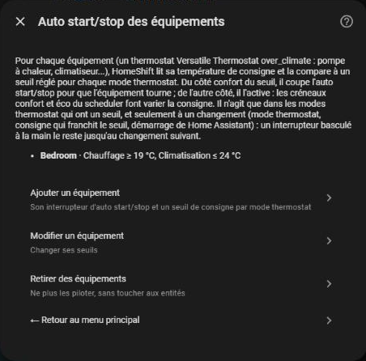
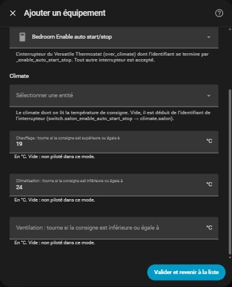
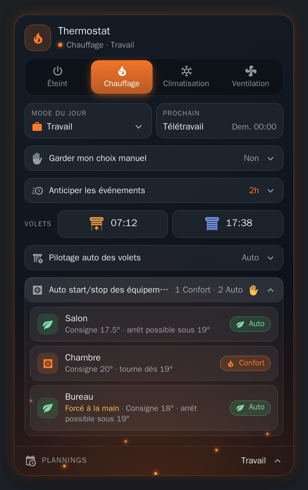

# Auto start/stop des équipements

[← Documentation](../../README.fr.md#documentation) · [English](../en/climates.md)

[Versatile Thermostat](https://github.com/jmcollin78/versatile_thermostat/blob/main/documentation/fr/feature-auto-start-stop.md) peut arrêter un équipement qui n'a rien à faire, et le redémarrer quand il le faut. Cela vaut pour ses thermostats `over_climate`, quel que soit l'appareil derrière (pompe à chaleur, climatiseur, unité réversible...). Chacun de ces thermostats a un `switch.<thermostat>_enable_auto_start_stop` qui active ou coupe cette fonction.

HomeShift pilote cet interrupteur selon la **température de consigne** du climate. Pour chaque mode thermostat, vous réglez un **seuil de consigne** : les créneaux confort de votre scheduler (une température haute en chauffage, basse en climatisation) gardent l'équipement en marche, et ses créneaux éco laissent Versatile Thermostat l'arrêter.

| Mode thermostat | Consigne du côté confort | Auto start/stop | L'équipement |
| --- | --- | --- | --- |
| **Chauffage** | supérieure ou égale au seuil | **coupé** | continue de tourner |
| **Climatisation**, **Ventilation** | inférieure ou égale au seuil | **coupé** | continue de tourner |
| L'un d'eux | de l'autre côté | **activé** | peut être arrêté par Versatile Thermostat |

## Ajouter un équipement

**Configurer → Auto start/stop des équipements → Ajouter un équipement** :

| Champ | À régler |
| --- | --- |
| **Interrupteur d'auto start/stop** | L'interrupteur du thermostat, dont l'identifiant se termine par `_enable_auto_start_stop`. Tout autre interrupteur est accepté. |
| **Climate** | Le climate dont on lit la température de consigne. Vide, il est déduit de l'interrupteur (`switch.salon_enable_auto_start_stop` donne `climate.salon`). |
| Un seuil par mode thermostat | En °C, avec sa règle dans le libellé : *Chauffage : tourne si la consigne est supérieure ou égale à*, *Climatisation* et *Ventilation : tourne si la consigne est inférieure ou égale à*. Laissez un mode vide et HomeShift ne pilote pas l'interrupteur dans ce mode. Il en faut au moins un. |

Chaque équipement a ses propres seuils. **Modifier un équipement** les change et affiche la consigne actuelle du climate, **Retirer des équipements** arrête de piloter les interrupteurs (ils gardent leur état).

### Exemple

Un équipement de salon qui doit tourner tant que le scheduler demande au moins 19° en chauffage, et au plus 24° en climatisation :

| Mode thermostat | Seuil | Créneau éco (consigne 17.5°) | Créneau confort (consigne 20°) |
| --- | --- | --- | --- |
| Chauffage | `19` | auto start/stop **activé**, peut s'arrêter | auto start/stop **coupé**, tourne |
| Climatisation | `24` | consigne 28° : **activé**, peut s'arrêter | consigne 23° : **coupé**, tourne |
| Ventilation | *(vide)* | non piloté | non piloté |

La consigne est lue sur le climate : cela marche que votre scheduler règle une température (`climate.set_temperature`) ou un preset (`eco`, `comfort`), car Versatile Thermostat transforme le preset en la consigne que le climate affiche.

## Quand HomeShift agit

Uniquement aux transitions :

- un changement de mode thermostat,
- une consigne qui franchit son seuil, dès que le climate la remonte,
- le démarrage de Home Assistant.

Il ne vous contredit jamais entre deux : un interrupteur basculé à la main, depuis son entité ou depuis la carte, reste tel quel jusqu'à la transition suivante. Un interrupteur indisponible est ignoré, tout comme un climate sans température de consigne à cet instant (éteint, indisponible) : son interrupteur reste tel quel. Le mode du jour n'intervient pas.

## Le suivre

`sensor.homeshift_auto_start_stop` compte les équipements gardés en marche et décrit chacun dans son attribut `climates` (voir la [référence](reference.md#sensorhomeshift_auto_start_stop)).

La [carte](card.md#auto-startstop-des-équipements) les montre dans une section repliable : **Auto** (Versatile Thermostat peut l'arrêter), **Confort** (il tourne) ou non piloté, avec la consigne face au seuil et un appui pour en basculer un à la main.

  

