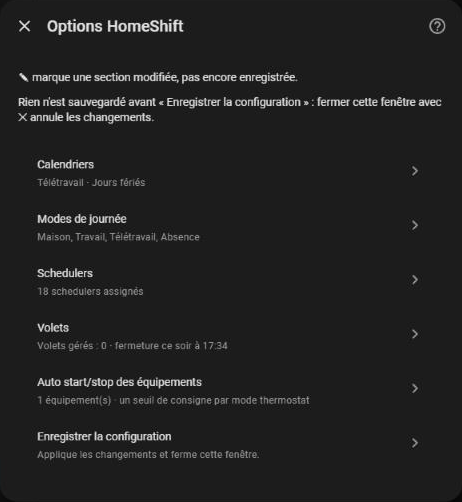

# Configuration

[← Documentation](../../README.fr.md#documentation) · [English](../en/configuration.md)

Tout se règle depuis **Paramètres → Appareils et services → HomeShift → Configurer**, et peut être changé à tout moment.

Chaque entrée du menu résume ses réglages. Valider une page ramène au menu, et **✎** marque les entrées modifiées et pas encore enregistrées. **Rien n'est enregistré avant « Enregistrer la configuration »** : fermer la fenêtre avec ✕ annule les changements.

Chaque page de la fenêtre est décrite, avec sa capture, dans la page de la fonction qu'elle règle :

| Entrée du menu | Ce qu'elle règle | Décrit dans |
| --- | --- | --- |
| **Calendriers** | Les calendriers de travail et de jours fériés | [Modes du jour → Calendriers](day-modes.md#calendriers) |
| **Modes de journée** | Le choix du mode, et les noms des modes | [Modes du jour → Règles de choix du mode](day-modes.md#règles-de-choix-du-mode) et [Noms des modes](day-modes.md#noms-des-modes) |
| **Schedulers** | Les interrupteurs Scheduler de chaque mode du jour | [Plannings](schedulers.md#plannings-par-mode-du-jour) |
| **Volets → Volets gérés** | Les volets ouverts et fermés chaque jour | [Volets → Les volets](covers.md#les-volets) |
| **Volets → Horaires d'ouverture et de fermeture** | Quand les volets s'ouvrent et se ferment | [Volets → Horaires quotidiens](covers.md#horaires-quotidiens) |
| **Volets → Protection contre la chaleur** | Les volets fermés contre la chaleur | [Volets → Protection contre la chaleur](covers.md#protection-contre-la-chaleur) |
| **Auto start/stop des équipements** | Les interrupteurs d'auto start/stop et un seuil de consigne par mode thermostat | [Auto start/stop des équipements](climates.md#ajouter-un-équipement) |

La durée de surcharge et la bascule anticipée ne sont pas dans cette fenêtre : voir [Modes du jour](day-modes.md#réglages).
