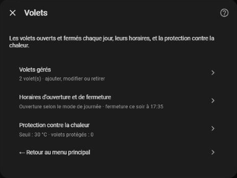
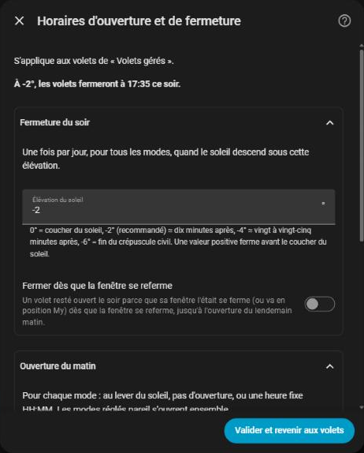
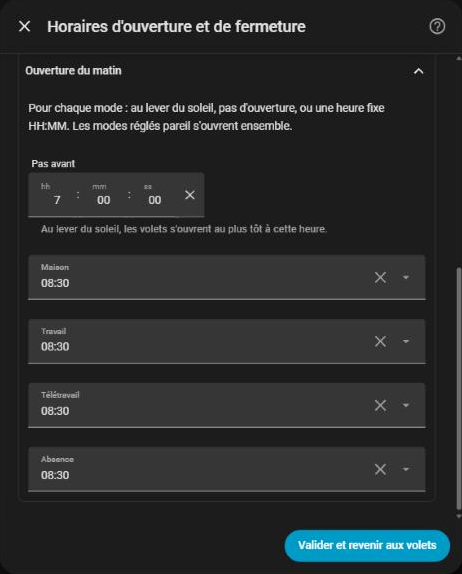
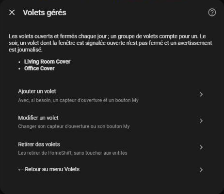
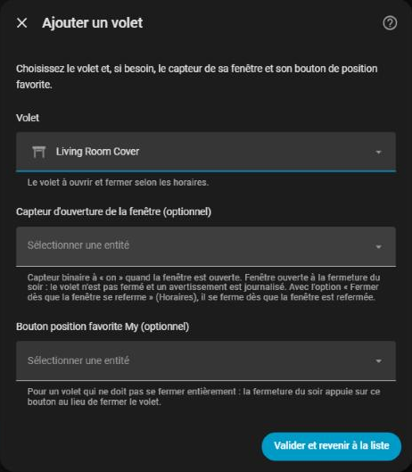
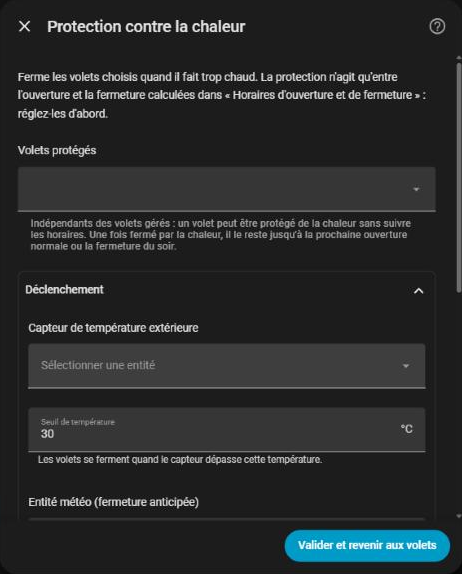
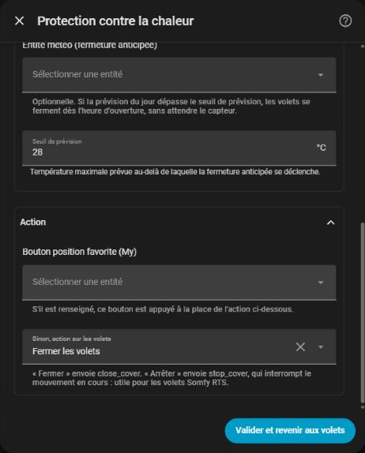

# Volets

[← Documentation](../../README.fr.md#documentation) · [English](../en/covers.md)

HomeShift ouvre et ferme les volets chaque jour sans aucune entité Scheduler, laisse un volet ouvert quand sa fenêtre l'est, permet de mettre des volets en pause, et en ferme certains contre la chaleur. Tout se règle dans **Configurer → Volets** :

| Menu | Ce qu'il règle |
| --- | --- |
| **Volets gérés** | Les volets ouverts et fermés chaque jour, un par un, chacun avec un capteur de fenêtre et un bouton My optionnels. Voir [Les volets](#les-volets) |
| **Horaires d'ouverture et de fermeture** | Quand ils s'ouvrent (par mode du jour) et se ferment (élévation du soleil). Voir [Horaires quotidiens](#horaires-quotidiens) |
| **Protection contre la chaleur** | Les volets fermés contre la chaleur, et quand. Voir [Protection contre la chaleur](#protection-contre-la-chaleur) |

## Horaires quotidiens

Une fois par jour, peu après minuit, HomeShift calcule les horaires du jour :

- **Ouverture**, selon le [mode du jour](day-modes.md), un champ par mode sous **Ouverture du matin** :
  - `sunrise` : au lever du soleil, mais jamais avant **Pas avant** (`07:00` par défaut),
  - `skip` : pas d'ouverture ce jour-là (les volets restent comme ils sont ; la protection contre la chaleur fonctionne quand même),
  - une heure fixe, `HH:MM` (`08:30` par défaut).
- **Fermeture**, la même pour tous les modes : quand le soleil couchant atteint l'**Élévation du soleil** de la fermeture du soir, voir [Quand les volets se ferment](#quand-les-volets-se-ferment).

Si le mode du jour change avant l'ouverture (un événement sur la journée que le calendrier n'affiche que quelques minutes après minuit, un mode choisi à la main le matin), l'heure d'ouverture est recalculée pour le nouveau mode. Une fois les volets ouverts, un changement ultérieur laisse les horaires du jour tels quels.

Un minuteur déclenche chaque action à sa minute, et la synchronisation toutes les 5 minutes rattrape un minuteur manqué (redémarrage). Chaque action a lieu au plus une fois par jour. Une commande qui échoue (intégration de volets qui ne répond pas, entité supprimée) est journalisée et renvoyée à la synchronisation suivante ; elle ne rend jamais les entités HomeShift indisponibles.

`sensor.homeshift_cover_open_time` et `sensor.homeshift_cover_close_time` affichent les horaires du jour.

### Réglages

Dans **Volets → Horaires d'ouverture et de fermeture** :

| Champ | Défaut | Rôle |
| --- | --- | --- |
| **Ouverture du matin**, un champ par mode du jour | `08:30` | `sunrise`, `skip` (pas d'ouverture) ou une heure `HH:MM` |
| **Pas avant** | `07:00` | L'heure la plus tôt d'une ouverture `sunrise`, et le début de la protection contre la chaleur un jour `skip` |
| **Élévation du soleil** (fermeture du soir) | `-2°` | Les volets se ferment quand le soleil couchant l'atteint, voir ci-dessous |
| **Fermer dès que la fenêtre se referme** | désactivé | Voir [Fermer dès que la fenêtre se referme](#fermer-dès-que-la-fenêtre-se-referme) |

### Quand les volets se ferment

Les volets se ferment quand le soleil couchant atteint l'**Élévation du soleil** réglée (fermeture du soir), en degrés au-dessus de l'horizon, sur la même échelle que `{{ state_attr('sun.sun', 'elevation') }}`. Vous réglez un **niveau de lumière**, pas un délai :

| Élévation | Environ | Lumière |
| --- | --- | --- |
| `+2°` | Coucher − ~15 min | Le soleil est encore là |
| `0°` | Coucher du soleil | Le soleil touche l'horizon |
| `-2°` *(défaut)* | Coucher + ~10 min | Crépuscule, on voit encore bien dehors |
| `-4°` | Coucher + ~20-25 min | La pièce est sombre |
| `-6°` | Coucher + ~35-40 min | Fin du crépuscule civil, il faut allumer |

La colonne « environ » vaut pour les latitudes moyennes : le délai varie un peu selon la latitude et la saison, le niveau de lumière non. Le formulaire traduit la valeur en heure de ce soir chez vous (**À -2°, les volets fermeront à 21:41 ce soir.**).

Le formulaire refuse une élévation que le soleil n'atteint jamais chez vous (une valeur positive sous laquelle reste le soleil d'hiver, n'importe quelle valeur au-delà du cercle polaire en juin). Si elle devient malgré tout inatteignable (maison qui a déménagé, entrée restaurée ailleurs), les volets se ferment au coucher du soleil et un avertissement est journalisé.

## Les volets

Ajoutez les volets un par un dans **Volets → Volets gérés** (**Ajouter un volet**, **Modifier un volet**, **Retirer des volets**). Un groupe de volets est un volet comme un autre : toute la maison peut tenir en une seule entrée. Chaque volet peut avoir :

- un **Capteur d'ouverture de la fenêtre** (un `binary_sensor` à `on` quand la fenêtre est ouverte),
- un **Bouton position favorite My**, pour un volet qui ne doit pas se fermer entièrement.

**Modifier un volet** change son capteur ou son bouton (videz un champ pour le retirer).

### Capteurs de fenêtre

**La fermeture du soir saute un volet dont la fenêtre est ouverte.** HomeShift le laisse ouvert, journalise un avertissement, et `binary_sensor.homeshift_covers_left_open` le signale jusqu'au lendemain.

- L'ouverture du matin n'est jamais sautée : une fenêtre ouverte n'est une raison que de ne pas fermer.
- Un capteur absent ou `unavailable` ne peut pas dire que la fenêtre est ouverte : le volet se ferme normalement, avec un avertissement.
- Un volet atteint par un groupe n'est pas protégé : HomeShift envoie la fermeture aux entités listées et ne regarde pas dans un groupe. Listez ce volet seul (et retirez-le du groupe).

#### Fermer dès que la fenêtre se referme

Avec **Fermer dès que la fenêtre se referme** activé (*Horaires d'ouverture et de fermeture*, **Fermeture du soir**), un volet laissé ouvert à cause de sa fenêtre se ferme dès qu'elle est refermée :

- seulement la nuit, de la fermeture du soir à l'ouverture du lendemain matin (après minuit compte aussi),
- vers sa position My s'il en a une,
- pas s'il a déjà été baissé à la main, ni tant qu'il est [en pause](#mettre-des-volets-en-pause) (il continue d'attendre),
- pas tant que le capteur est `unavailable` (il continue d'attendre),
- même après un redémarrage : une fenêtre refermée pendant que Home Assistant était arrêté est rattrapée à la synchronisation suivante.

Sans cette option, un volet sauté reste ouvert pour la nuit, et l'avertissement sert de rappel pour le fermer à la main.

### Position My au lieu d'une fermeture complète

Donnez à un volet un **Bouton position favorite My** (le bouton qui envoie un volet Somfy RTS ou similaire à sa position favorite) : la fermeture du soir appuie sur ce bouton au lieu d'envoyer `close_cover`. Une fenêtre ouverte reste prioritaire, et l'ouverture du matin ne change pas. C'est par volet, indépendant du bouton My de la protection contre la chaleur.

## Ouvrir et fermer à la demande

`button.homeshift_open_covers` et `button.homeshift_close_covers` (ainsi que les actions `homeshift.open_covers` / `homeshift.close_covers`, et les horaires sur la [carte](card.md#volets)) envoient les commandes quotidiennes à tout moment :

- **Ouvrir** ouvre tous les volets de la liste, même un jour `skip`.
- **Fermer** suit les règles du soir : un volet à la fenêtre ouverte reste ouvert, un volet avec bouton My reçoit un appui.
- Les horaires du jour ne changent pas : les actions prévues ont toujours lieu à leur heure.
- Les volets [en pause](#mettre-des-volets-en-pause) ne sont pas touchés.

## Mettre des volets en pause

Sortez des volets de l'automatisation pour un temps, par exemple une chambre gardée dans le noir quelques jours. Un volet en pause ne reçoit ni l'ouverture ni la fermeture quotidiennes, la protection contre la chaleur ne le touche pas, et les commandes à la demande le sautent. Une pause dure un temps donné, jusqu'à une date, ou jusqu'à la reprise, et survit à un redémarrage.

Mettez en pause et reprenez depuis la [carte](card.md#pilotage-auto-des-volets), ou avec les actions [`homeshift.inhibit_covers` et `homeshift.resume_covers`](reference.md#homeshiftinhibit_covers). `sensor.homeshift_covers_inhibited` liste les volets en pause.

Mettre en pause ou reprendre ne fait jamais bouger un volet. À la fin d'une pause, le volet participe à l'action prévue suivante ; une ouverture du matin manquée n'est pas rejouée l'après-midi. La protection contre la chaleur fait exception : elle reste armée, et un volet libéré un après-midi chaud peut encore être fermé par elle. Le bouton My de la protection contre la chaleur bouge tous ses volets d'un coup : il n'est pas pressé tant que l'un d'eux est en pause.

## Protection contre la chaleur

HomeShift peut fermer des volets contre la chaleur, sans automatisation et sans plage horaire à régler. Ses volets (**Volets protégés**) forment une liste séparée des volets quotidiens : un volet plein sud peut rester sous la protection pendant que les autres suivent les horaires quotidiens.

**Elle a besoin des horaires quotidiens** : elle fonctionne de l'heure d'ouverture à l'heure de fermeture du jour. Un jour `skip` (typiquement *Absence*), elle commence à l'heure du lever du soleil : `skip` empêche l'ouverture, jamais la protection, puisque personne n'est là pour fermer à la main. S'il fait déjà chaud à l'heure d'ouverture, la position de protection s'applique tout de suite au lieu d'ouvrir d'abord.

Une fois fermé par la protection, un volet le reste jusqu'à la fin de la journée ; il bouge de nouveau à l'ouverture du lendemain ou à la fermeture du soir. `binary_sensor.homeshift_cover_heat_active` est à `on` tant que les conditions sont réunies.

### Réglages

Dans **Volets → Protection contre la chaleur** :

| Champ | Défaut | Rôle |
| --- | --- | --- |
| **Volets protégés** | — | Les volets à fermer contre la chaleur (nécessite aussi des volets gérés) |
| **Capteur de température extérieure** | — | La température surveillée |
| **Seuil de température** | `30 °C` | Au-dessus, les volets se ferment |
| **Entité météo (fermeture anticipée)** | — | Prévisions journalières, pour la fermeture anticipée (optionnel) |
| **Seuil de prévision** | `28 °C` | Au-dessus de cette maximale prévue, les volets se ferment le matin |
| **Bouton position favorite (My)** | — | Pressé à la place de l'action sur les volets |
| **Sinon, action sur les volets** | `close_cover` | `close_cover`, ou `stop_cover` pour arrêter le mouvement |

### Fermeture réactive

À chaque synchronisation et à chaque changement du capteur de température, si l'on est dans la plage du jour et que la température extérieure dépasse le **Seuil de température** (`30 °C` par défaut), HomeShift appuie sur le **Bouton position favorite (My)** s'il est réglé, sinon applique l'**action sur les volets** : `close_cover` (par défaut) ou `stop_cover` (arrête le mouvement, utile pour les volets Somfy RTS).

Elle a lieu au plus une fois par jour. Rien n'est envoyé si tous les volets protégés sont déjà `closed`, et une commande qui échoue est retentée à la vérification suivante.

### Fermeture anticipée (prévisions)

Avec une **Entité météo (fermeture anticipée)** fournissant des prévisions journalières, HomeShift vérifie aussi une fois par jour, au début de la plage, si la température maximale prévue dépasse le **Seuil de prévision** (`28 °C` par défaut). Si oui, les volets se ferment aussitôt (ou ne s'ouvrent pas du tout), avant que le capteur extérieur ne franchisse le seuil. La fermeture réactive continue le reste de la journée, au cas où la prévision se trompe. Laissez l'entité météo vide pour ne garder que la fermeture réactive.

## Après un redémarrage

Ce que les volets ont déjà fait aujourd'hui (ouverts, fermés, fermés contre la chaleur, prévision vérifiée), les volets restés ouverts, ceux qui attendent leur fenêtre et les pauses sont enregistrés : un redémarrage en pleine journée ne perd rien. Ces données sont supprimées avec l'intégration.
