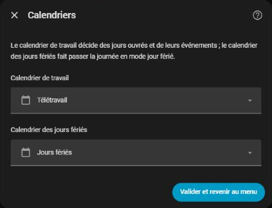
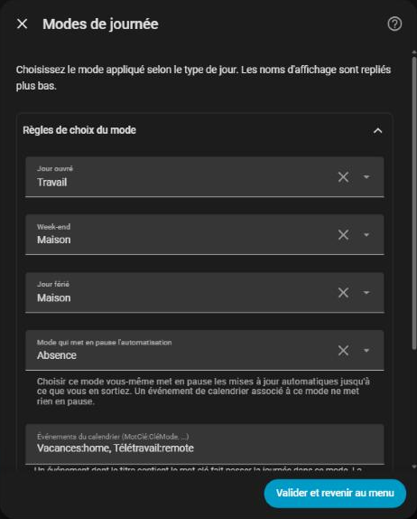
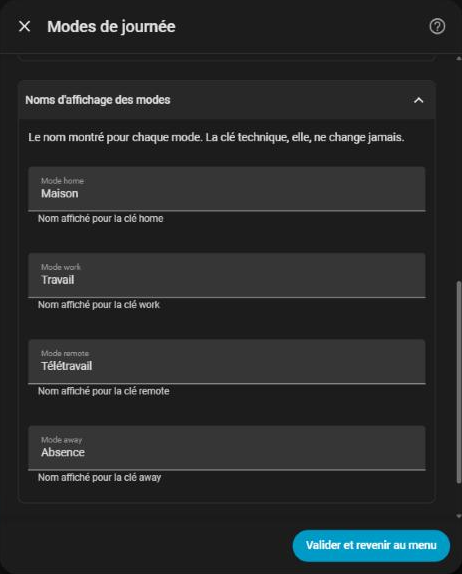

# Modes du jour

[← Documentation](../../README.fr.md#documentation) · [English](../en/day-modes.md)

HomeShift garde un seul **mode du jour** pour toute la maison, affiché et réglé par `select.homeshift_day_mode`. Il y en a quatre, avec des clés fixes et des noms que vous pouvez changer (voir [Noms des modes](#noms-des-modes)) :

| Clé | Anglais | Français |
| --- | --- | --- |
| `home` | Home | Maison |
| `work` | Work | Travail |
| `remote` | Remote | Télétravail |
| `away` | Away | Absence |

Toutes les 5 minutes, et à l'heure pile pour les changements qu'il peut prévoir, HomeShift lit vos calendriers, choisit le mode, active les [plannings](schedulers.md) de ce mode et coupe les autres. Les [volets](covers.md) et l'[auto start/stop des équipements](climates.md) suivent le mode eux aussi.

## Comment le mode est choisi

HomeShift regarde l'événement en cours dans votre calendrier de travail, et votre calendrier des jours fériés, dans cet ordre :

| Priorité | Condition | Mode |
| --- | --- | --- |
| 1 | L'événement en cours correspond aux **Événements du calendrier** | Le mode associé (ex. `Télétravail`) |
| 2 | Un événement horaire correspondant commence dans le délai de [bascule anticipée](#bascule-anticipée) | Le mode associé, en avance |
| 3 | On est samedi ou dimanche | Le mode **Week-end** |
| 4 | C'est un jour férié | Le mode **Jour férié** |
| 5 | Rien de tout cela | Le mode **Jour ouvré** (ex. `Travail`) |

Les **Événements du calendrier** associent des mots-clés du titre des événements à des modes : `Vacances:home, Télétravail:remote` par défaut sur une installation française (`Vacation:home, Remote:remote` en anglais). Un mot-clé est reconnu n'importe où dans le titre, sans tenir compte des majuscules.

`sensor.homeshift_next_mode` et `sensor.homeshift_next_mode_at` indiquent le prochain mode et son heure, et un minuteur change le mode à cette minute plutôt qu'à la synchronisation suivante.

## Réglages

Dans **Configurer → Calendriers** et **Configurer → Modes de journée**, voir [Configuration](configuration.md) pour le fonctionnement de la fenêtre.

### Calendriers



| Champ | Rôle |
| --- | --- |
| **Calendrier de travail** | Le calendrier de vos événements de travail ou d'agenda (obligatoire) |
| **Calendrier des jours fériés** | Le calendrier des jours fériés (obligatoire) |

### Règles de choix du mode



| Champ | Défaut | Rôle |
| --- | --- | --- |
| **Jour ouvré** | `Travail` | Mode d'un jour de semaine sans événement |
| **Week-end** | `Maison` | Mode du samedi et du dimanche |
| **Jour férié** | `Maison` | Mode des jours fériés |
| **Mode qui met en pause l'automatisation** | `Absence` | Quand *vous* choisissez ce mode, le calendrier ne le change plus, voir [Le mode Absence](#le-mode-absence) |
| **Événements du calendrier** | `Vacances:home, Télétravail:remote` | Mots-clés du titre des événements et la clé du mode qu'ils donnent (`Vacation:home, Remote:remote` en anglais) |

### Noms des modes



**Noms d'affichage des modes** et **Noms des modes thermostat** : le nom de chaque mode. Les quatre modes du jour (clés `home`, `work`, `remote`, `away`) et les quatre modes thermostat (`off`, `heating`, `cooling`, `ventilation`) se renomment mais ne s'ajoutent ni ne se suppriment. Les noms des modes thermostat servent aussi d'[étiquettes des plannings](schedulers.md#étiquettes-thermostat).

La **durée de surcharge** et la **bascule anticipée** ne sont pas dans cette fenêtre : réglez-les depuis leurs entités (`number.homeshift_override_duration`, `number.homeshift_early_switch`) ou depuis la [carte](card.md). Voir [Bascule anticipée](#bascule-anticipée) et [Changer le mode à la main](#changer-le-mode-à-la-main).

## Événements d'une demi-journée

Un événement qui ne couvre que le matin ou que l'après-midi n'applique son mode que pendant ce créneau : le mode revient au mode par défaut le reste de la journée.

## Bascule anticipée

La **bascule anticipée** (`number.homeshift_early_switch`, de 0 à 480 minutes, `0` par défaut) démarre le mode d'un événement horaire en avance, par exemple pour laisser au chauffage le temps de chauffer :

```
Événement :  Télétravail  14:00 ──────────── 18:00
bascule anticipée = 120 min
                         ↑
                      12:00  ← HomeShift passe en Télétravail ici
```

- Elle ne vaut que pour les événements **horaires** : un événement sur la journée entière (jour férié) n'est jamais anticipé.
- `sensor.homeshift_next_mode_at` montre l'heure anticipée, pas le début de l'événement.
- `0` désactive la bascule anticipée.

## Changer le mode à la main

Choisissez un mode dans la liste (ou sur la carte) à tout moment. La **durée de surcharge** (`number.homeshift_override_duration`, de 0 à 1440 minutes, `0` par défaut) garde alors votre choix pendant ce temps avant que le calendrier reprenne la main. Avec `0`, le prochain passage du calendrier le remplace. Une surcharge en cours survit à un redémarrage.

### Le mode Absence

Quand **vous** choisissez le **Mode qui met en pause l'automatisation** (`Absence` par défaut), HomeShift ne change plus le mode tant que vous n'en choisissez pas un autre : c'est le but de ce mode.

Un événement du calendrier associé au mode Absence ne fige **rien** : il règle le mode comme n'importe quel événement, et le mode reprend son cours à la fin de l'événement. Sinon, un seul événement figerait l'intégration pour de bon.

## Quand un calendrier est illisible

Un calendrier de travail ou de jours fériés absent, `unavailable` ou `unknown` (panne CalDAV ou Google, intégration encore en cours de chargement au démarrage) ne dit rien de la journée : HomeShift ne le lit **pas** comme « aucun événement ». Il garde le mode en cours, journalise un avertissement au début de la panne et une ligne à la fin, et reprend normalement dès que le calendrier répond. Un jour de télétravail ne bascule pas en *Travail* puis revient, et une absence posée par un événement n'est pas annulée.

La [carte](card.md#calendrier-illisible) affiche un bandeau ambre tant que la panne dure, et le sélecteur du mode du jour porte le début de la panne dans son attribut `calendar_error`.

Les volets n'attendent pas le calendrier : leurs horaires continuent, calculés avec le mode conservé, et recalculés quand le calendrier répond.

## Après un redémarrage

Le mode du jour, le mode thermostat et une surcharge en cours sont enregistrés et restaurés au démarrage de Home Assistant.
