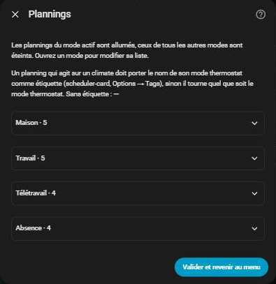

# Plannings

[← Documentation](../../README.fr.md#documentation) · [English](../en/schedulers.md)

HomeShift pilote les interrupteurs de l'[intégration Scheduler](https://github.com/nielsfaber/scheduler-component) selon le [mode du jour](day-modes.md) et le mode thermostat : les bons plannings de chauffage, de climatisation ou d'éclairage tournent sans aucune automatisation à écrire.

## Plannings par mode du jour

Dans **Configurer → Plannings**, associez un ou plusieurs interrupteurs Scheduler à chaque mode du jour. Quand le mode change :

- les interrupteurs du **mode en cours** sont **activés**,
- ceux de **tous les autres modes** sont **désactivés**.

Par exemple, un planning de chauffage pour les jours de télétravail et un autre pour les jours au bureau, chacun ne tournant que les jours qui le concernent.

Les associations sont enregistrées par **clé** de mode (`home`, `work`, ...) : renommer un mode ou changer la langue de Home Assistant les conserve. Un interrupteur qui ne répond pas (supprimé, intégration Scheduler déchargée) est signalé dans le journal et n'empêche pas les autres.

La page nomme les plannings assignés qui agissent sur un climate sans étiquette thermostat (voir plus bas) : ils tournent quel que soit le mode thermostat, Éteint compris, ce qui est presque toujours une étiquette oubliée.

`homeshift.refresh_schedulers` réapplique les interrupteurs à la demande.

## Mode thermostat

`select.homeshift_thermostat_mode` (`Eteint`, `Chauffage`, `Climatisation`, `Ventilation` par défaut sur une installation française) choisit quels plannings de climat peuvent tourner. HomeShift les reconnaît à leurs **étiquettes**.

### Étiquettes thermostat

Donnez à chaque planning qui chauffe ou climatise le **nom de son mode thermostat comme étiquette** (dans l'éditeur de la scheduler-card, **Options → Tags**), écrit exactement comme dans HomeShift :

| Interrupteur | Étiquettes | Rôle |
| --- | --- | --- |
| `switch.schedule_maison_chauffage` | `Chauffage` | Chauffage quand vous êtes à la maison |
| `switch.schedule_travail_chauffage` | `Chauffage` | Chauffage les jours au bureau |
| `switch.schedule_maison_clim` | `Climatisation` | Climatisation quand vous êtes à la maison |
| `switch.schedule_simulation_presence` | *(aucune)* | Éclairage, sans rapport avec le thermostat |

Un planning étiqueté ne tourne que lorsque le thermostat est dans son mode (et que son mode du jour est le mode en cours). Thermostat **Éteint**, tous les plannings étiquetés sont coupés, quel que soit le mode du jour. Les plannings sans étiquette thermostat ne suivent que le mode du jour.

### Climatiseurs

Couper un planning laisse son climatiseur dans son état : une PAC qui climatise quand on choisit **Éteint** continuerait de climatiser. Un changement de mode thermostat (depuis la liste ou la carte) pilote donc aussi les entités `climate` sur lesquelles agissent les plannings étiquetés :

- **Éteint** : chacune est éteinte (`hvac_mode: off`).
- **Chauffage / Climatisation / Ventilation** : les climatiseurs des plannings étiquetés avec ce mode passent en `heat` / `cool` / `fan_only` (s'ils le permettent), et les plannings activés de ce mode exécutent leur créneau en cours (`scheduler.run_action`) pour que la consigne s'applique tout de suite. Les climatiseurs pilotés uniquement par les plannings d'un autre mode sont éteints.

Un climatiseur déjà dans le bon mode, indisponible ou sans ce mode HVAC n'est pas touché. Les climatiseurs qu'aucun planning étiqueté ne pilote ne sont jamais touchés.

## Sur la carte

Avec l'intégration Scheduler, la [carte](card.md#plannings) montre les plannings de chaque mode du jour sous forme de frises de 24 h, et permet de les modifier. Donnez aussi à chaque planning le **nom de son mode du jour** comme étiquette, pour que la carte le trouve.
